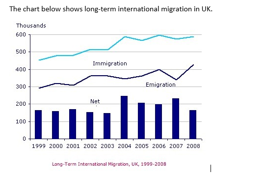

# 01 英国移民(混合图:折线 + 柱形)

- 题型:混合图(Task 1,两条折线 + 一组柱形,10 个年份)
- 来源:`小作文/混合图/英国移民.docx`
- 首次学习:2026-11-23
- 原图:`../question/01.png`(已对照)

## 题目

The chart below shows long-term international migration in UK.



### 先看清这张图

- **两条折线:** Immigration(迁入,浅蓝)、Emigration(迁出,深蓝)。
- **一组柱形:** Net(净移民)。
- 纵轴单位是 **Thousands(千人)**,所以 `450` 就是 450,000 人。
- **净移民 = 迁入 − 迁出。** 三个数据有数学关系,可以用来检验读数。

### 读图数据(我的近似读数)

单位:千人。线图和柱形要估读,误差约 ±10。

| 年份 | Immigration | Emigration | Net |
| --- | --- | --- | --- |
| 1999 | 约 450 | 约 290 | 约 165 |
| 2000 | 约 480 | 约 320 | 约 160 |
| 2001 | 约 480 | 约 310 | 约 170 |
| 2002 | 约 515 | 约 365 | 约 150 |
| 2003 | 约 515 | 约 365 | 约 150 |
| 2004 | 约 590 | 约 345 | 约 245 |
| 2005 | 约 565 | 约 365 | 约 205 |
| 2006 | 约 595 | 约 400 | 约 200 |
| 2007 | 约 575 | 约 340 | 约 235 |
| 2008 | 约 590 | 约 425 | 约 165 |

> 验算:1999 年 450 − 290 ≈ 160(柱形约 165);2004 年 590 − 345 = 245;2007 年 575 − 340 = 235;2008 年 590 − 425 = 165。读数是一致的。

## 原范文

The chart gives information about UK immigration, emigration and net migration between 1999 and 2008.

Both immigration and emigration rates rose over the period shown, but the figures for immigration were significantly higher. Net migration peaked in 2004 and 2007.

In 1999, over 450,000 people came to live in the UK, while the number of people who emigrated stood at just under 300,000. The figure for net migration was around 160,000, and it remained at a similar level until 2003. From 1999 to 2004, the immigration rate rose by nearly 150,000 people, but there was a much smaller rise in emigration. Net migration peaked at almost 250,000 people in 2004.

After 2004, the rate of immigration remained high, but the number of people emigrating fluctuated. Emigration fell suddenly in 2007, before peaking at about 420,000 people in 2008. As a result, the net migration figure rose to around 240,000 in 2007, but fell back to around 160,000 in 2008.

### 对照原图后的核对结果

| 范文里的说法 | 与图是否一致 |
| --- | --- |
| 迁入和迁出都上升,迁入明显更高 | 一致(迁入约 450 → 590;迁出约 290 → 425;每年迁入都高于迁出) |
| 净移民在 2004 年和 2007 年达到峰值 | 一致(约 245、235) |
| 1999 年迁入 `over 450,000` | **略偏高**:我读图约 450,`around 450,000` 更准 |
| 1999 年迁出 just under 300,000 | 一致(约 290) |
| 1999–2003 年净移民约 160,000,水平相近 | 一致(约 150–170) |
| 1999–2004 年迁入增加 nearly 150,000 | 一致(约 450 → 590,增加约 140) |
| 迁出增加得小得多 | 一致(约 290 → 345) |
| 2004 年净移民约 250,000 | 一致(约 245) |
| 2007 年迁出突然下降,2008 年达到约 420,000 | 一致(约 340 → 425) |
| 净移民 2007 年约 240,000,2008 年回落到约 160,000 | 一致 |
| `immigration rate` / `the rate of immigration` | **用词不准**:图里是人数(千),不是比率 |

数据基本正确,主要问题是 `rate` 的用法。

## 参考修改版(Claude)

The chart gives information about UK immigration, emigration and net migration between 1999 and 2008, in thousands of people.

Both immigration and emigration rose over the period shown, but the number of immigrants was significantly higher in every year, so net migration was positive throughout. Net migration peaked in 2004 and 2007.

In 1999, around 450,000 people came to live in the UK, while the number of people who emigrated stood at just under 300,000. The figure for net migration was around 160,000, and it remained at a similar level until 2003. From 1999 to 2004, immigration rose by nearly 150,000 people, but there was a much smaller rise in emigration. Net migration peaked at almost 250,000 people in 2004.

After 2004, immigration remained high, but the number of people emigrating fluctuated. Emigration fell suddenly in 2007, before peaking at about 420,000 people in 2008. As a result, the net migration figure rose to around 240,000 in 2007, but fell back to around 160,000 in 2008.

### 修改说明

| 位置 | 原文 | 修改 | 原因 |
| --- | --- | --- | --- |
| 开头 | …between 1999 and 2008. | …between 1999 and 2008, in thousands of people. | 说明单位 |
| 概述 | …the figures for immigration were significantly higher. | …the number of immigrants was significantly higher in every year, so net migration was positive throughout | 点出三个数据的关系:迁入每年都高于迁出,所以净移民每年都是正数 |
| 用词 | immigration rate / the rate of immigration | immigration / the number of immigrants | 图里是人数,rate 通常指比率 |
| 数据 | over 450,000 | around 450,000 | 读图约 450 |

这篇范文质量很高,修改都是小改动。

## 这篇值得学的地方

**1. 混合图:先分清每个数据系列,再看它们的关系**
- Immigration(迁入):进入英国的人数。
- Emigration(迁出):离开英国的人数。
- Net migration(净移民)= 迁入 − 迁出。

三个数据有数学关系,这可以帮你**检验读数**(迁入 590 − 迁出 345 = 净移民 245),也能**解释变化**:2007 年迁出下降,所以净移民上升;2008 年迁出大幅上升,净移民回落。

**2. 怎么写:不是一个系列一段**
范文按**时间**分段,每段里同时写三个数据:
- 第 3 段:1999–2004,迁入上升很多、迁出上升很少,所以净移民在 2004 年达到峰值。
- 第 4 段:2004–2008,迁入保持高位,迁出波动,净移民随之变化。

概述写关系:迁入每年都高于迁出,两者都上升,净移民在 2004 年和 2007 年出现峰值。

**3. 数量,不是比率**
图里的单位是 thousands(千人),所以是**人数**:`the number of immigrants`、`immigration rose by nearly 150,000 people`。`rate` 是比率(每千人的比例),这里不用。

**4. 单位换算**
`Thousands` 的 `450` 就是 `450,000 people`。千位加逗号,和表格 01 地下铁的 `1,191 million` 是同一类。

**5. 描述起伏的词**

| 说法 | 例子 |
| --- | --- |
| peaked at / peaked in | Net migration peaked at almost 250,000 in 2004 |
| fluctuated | the number of people emigrating fluctuated |
| fell suddenly / sharply | Emigration fell suddenly in 2007 |
| fell back to | fell back to around 160,000 in 2008 |
| remained high / at a similar level | remained at a similar level until 2003 |
| rose by nearly 150,000 | immigration rose by nearly 150,000 people |
| before peaking at | before peaking at about 420,000 people in 2008 |

**6. 因果连接**
`As a result, the net migration figure rose to around 240,000 in 2007`:迁出下降导致净移民上升。

**7. 时态**
1999–2008 是具体年份,数据句用过去时(rose、stood at、remained、fell、peaked)。

**8. 值得抄的句型(介词练习)**

| 句型 | 说明 |
| --- | --- |
| the number of people who emigrated **stood at** just under 300,000 | stand **at** + 数值 |
| it **remained at** a similar level **until** 2003 | remain **at**;until |
| **From** 1999 **to** 2004, immigration rose **by** nearly 150,000 people | from … to;rose **by** + 幅度 |
| there was a much smaller rise **in** emigration | a rise **in** + 事物 |
| Net migration **peaked at** almost 250,000 people **in** 2004 | peaked **at** + 数值 |
| Emigration fell suddenly **in** 2007, **before peaking at** about 420,000 | before + 动名词 |
| the net migration figure rose **to** around 240,000, but fell back **to** around 160,000 | rose **to** + 终点 |
| the figures **for** immigration were significantly higher | the figures **for** |

**9. 混合图和其他图的对比**

| | 单一图形 | 混合图 |
| --- | --- | --- |
| 读图 | 一种图形 | 线 + 柱,要看清每个系列代表什么 |
| 数据关系 | 独立 | **有关系**(净移民 = 迁入 − 迁出) |
| 分段 | 按趋势 / 类别 | **按时间,每段里同时写几个系列** |

---

## 版本 1:我的初稿(2026-11-23,原样保留,不改动)

```text
The chart given information about the UK imigration、emigration and net migration, in thousand of people.
Over the period, both imigration and emigration rose, but the number of imigration rose significantly in every year, so the net imigration was positive throughtout. The net migration peak in 2004 and 2007.

In 1994, there were around 0.45 million people came to UK for live, while the number of imigration was just under 0.3 billion. The number of emigration was around 0.16 million, and it remained the level until 2003. From 1999 to 2004, the number of imigration rose by around 150 thousand, while that of emigration was much smaller. The net migration peaked at nearly 250 thousand in 2004.

After 2004, the number of imigration was still high, while that of emigration fluctuated. The number of imigration fell suddenly in 2007, and it peak at 420 thousand in 2008. As a result, the number of migration peaked at 240 thousand in 2007, while it fell back to 160 thousand in 2008.
```

> 说明:这一份的结构和内容点和「参考修改版」几乎一一对应,句子是你自己组织的,语言错误是真实的。

### 逐句批改

**第 1 段(开头和概述)**

| 问题 | 类型 | 改正 |
| --- | --- | --- |
| The chart **given** information | 缺谓语动词(第 2 次:表格 05 里也是 given) | The chart **gives** information |
| **imigration**、emigration | 拼写;用了中文顿号(第 4 次) | **immigration**, emigration |
| in **thousand of** people | thousands | in **thousands** of people |
| the number of **imigration** rose significantly in every year | **内容错误**:迁入不是「每年都在大幅上升」,而是「每年都明显高于迁出」;the number of immigration 搭配不对 | the number of **immigrants** was significantly **higher** in every year |
| the **net imigration** was positive **throughtout** | net migration(不是 net immigration);throughout 拼写 | net **migration** was positive **throughout** |
| The net migration **peak** in 2004 and 2007 | 时态 | peaked |

> 改正:The chart gives information about UK immigration, emigration and net migration, in thousands of people. Over the period, both immigration and emigration rose, but the number of immigrants was significantly higher in every year, so net migration was positive throughout. Net migration peaked in 2004 and 2007.

**第 2 段(1999–2004)**

| 问题 | 类型 | 改正 |
| --- | --- | --- |
| **In 1994** | **年份错误**:图是 1999–2008 | **In 1999** |
| there were around 0.45 million people **came** to UK **for live** | 两个动词;to live;the UK | around 450,000 people **came to live in the UK** |
| the number of **imigration** was just under **0.3 billion** | **内容错误**:这是**迁出**(emigration),不是迁入;**单位错误**:300 千人是 0.3 million,不是 0.3 billion | the number of people who **emigrated** was just under **300,000** |
| The number of **emigration** was around 0.16 million | **内容错误:160,000 是净移民(net migration),不是迁出** | The **net migration** figure was around **160,000** |
| it **remained the level** until 2003 | 漏 at,level 前要有 a similar | it remained **at a similar level** until 2003 |
| the number of imigration rose by around 150 thousand | by 用对了;the number of immigration 搭配不对 | **immigration** rose by around 150,000 people |
| while that **of emigration was much smaller** | 意思不对:要说的是「**上升幅度**小得多」,不是迁出的人数小 | while there was **a much smaller rise in emigration** |

> 改正:In 1999, around 450,000 people came to live in the UK, while the number of people who emigrated was just under 300,000. The net migration figure was around 160,000, and it remained at a similar level until 2003. From 1999 to 2004, immigration rose by around 150,000 people, while there was a much smaller rise in emigration. Net migration peaked at nearly 250,000 in 2004.

**第 3 段(2004–2008)**

| 问题 | 类型 | 改正 |
| --- | --- | --- |
| the number of imigration was still high | 搭配;可以更简洁 | immigration remained high |
| while **that of emigration** fluctuated | ✓ that of 用对了 | |
| **The number of imigration fell** suddenly in 2007, and it **peak** at 420 thousand in 2008 | **内容错误:2007 年下降、2008 年达到 420 千人的是迁出(emigration),不是迁入**;peak 时态 | **Emigration fell** suddenly in 2007, and **peaked** at 420,000 in 2008 |
| the number of **migration** peaked at 240 thousand in 2007 | 应为 net migration | **net migration** rose again to around 240,000 in 2007 |
| it fell back to 160 thousand in 2008 | ✓ 对了 | |

> 改正:After 2004, immigration remained high, while emigration fluctuated. Emigration fell suddenly in 2007, and peaked at 420,000 in 2008. As a result, net migration rose again to around 240,000 in 2007, while it fell back to 160,000 in 2008.

### 最小修订(保留你的思路,只改错)

The chart gives information about UK immigration, emigration and net migration, in thousands of people.

Over the period, both immigration and emigration rose, but the number of immigrants was significantly higher in every year, so net migration was positive throughout. Net migration peaked in 2004 and 2007.

In 1999, around 450,000 people came to live in the UK, while the number of people who emigrated was just under 300,000. The net migration figure was around 160,000, and it remained at a similar level until 2003. From 1999 to 2004, immigration rose by around 150,000 people, while there was a much smaller rise in emigration. Net migration peaked at nearly 250,000 in 2004.

After 2004, immigration remained high, while emigration fluctuated. Emigration fell suddenly in 2007, and peaked at 420,000 in 2008. As a result, net migration rose again to around 240,000 in 2007, while it fell back to 160,000 in 2008.

### 做得好的地方

- **数据覆盖完整:** 迁入、迁出、净移民三个系列,以及峰值、波动、2007–2008 的变化,都写到了。
- **概述写出了三个数据的关系:** 迁入每年都高于迁出,所以净移民每年为正。
- **变化词和介词用对了:** `rose by around 150 thousand`、`peaked at nearly 250 thousand in 2004`、`fell back to 160 thousand`、`remained … until 2003`、`fluctuated`、`From 1999 to 2004`。
- **`that of emigration`** 的 that of 用对了(指代 number)。
- **`As a result`** 的因果连接用对了。
- **缺句号 0 处;时态基本是过去时。**
- 单位换算大部分是对的:`0.45 million`、`150 thousand`、`420 thousand`。

### 本篇的介词和搭配(对照 `grammer.md`)

| 你写的 | 正确 | 规则 |
| --- | --- | --- |
| The chart **given** information | The chart **gives** information | 开头句要有谓语动词 |
| in **thousand of** people | in **thousands** of people | |
| people **came to UK for live** | people **came to live in the UK** | to + 动词原形;in the UK |
| remained **the level** | remained **at a similar level** | remain **at** |
| the number **of imigration** | the number **of immigrants** / immigration | |
| the number **of migration** | net migration | |
| rose **by** around 150 thousand | ✓ 对了 | |
| peaked **at** nearly 250 thousand **in** 2004 | ✓ 对了 | |
| fell back **to** 160 thousand | ✓ 对了 | |
| **From** 1999 **to** 2004 | ✓ 对了 | |

### 语法笔记

**1. 混合图:三个系列的标签要对准**
这篇有 3 处把系列写混了:

| 你写的 | 其实是 |
| --- | --- |
| 1999 年 `imigration` just under 0.3 billion | **迁出**(emigration),约 300,000 |
| `emigration` was around 0.16 million | **净移民**(net migration),约 160,000 |
| 2007 年 `imigration` fell suddenly,2008 年 peak at 420 thousand | **迁出**(emigration) |

方法:写之前,在草稿纸上列一张小表,三列分别写 I(迁入)、E(迁出)、N(净移民),把关键年份的数字填进去,并用 N = I − E 验算。写每个数字前,问自己「这是哪一列」。这和表格 01 的 Tokyo / Kyoto、表格 05 的 19% / 7% 是同一类错误。

**2. immigration、immigrants、emigrate**

| 词 | 意思 | 例句 |
| --- | --- | --- |
| immigration | 迁入(抽象) | immigration rose by around 150,000 people |
| immigrants | 迁入的人(可数) | the number of immigrants was significantly higher |
| emigration | 迁出 | emigration fell suddenly in 2007 |
| emigrate | 迁出(动词) | the number of people who emigrated |
| net migration | 净移民 | net migration was positive throughout |

✗ `the number of imigration`;✓ `the number of immigrants` 或直接 `immigration rose by …`。

**3. 拼写:immigration 有两个 m**
你把 `immigration` 拼成 `imigration`,共 8 次。**im-mi-gra-tion**,`immigrate / immigrant / immigration` 都是两个 m。`throughtout` 应为 `throughout`。

**4. 单位:thousands 怎么换算**

| 图上 | 正文里 |
| --- | --- |
| 450(单位 thousands) | 450,000 / 450 thousand / 0.45 million |
| 300 | just under 300,000 / 0.3 million |
| ✗ | 0.3 **billion**(= 3 亿) |

1 million = 1,000 thousand;1 billion = 1,000 million。

**5. 年份写完回图核对**
`In 1994`:图是 1999–2008。

**6. to live in the UK**
`came to live in the UK`。✗ `came to UK for live`(UK 前要有 the,for 后面不能接动词原形)。

**7. remain at**
`remained at a similar level`;`remained at 100%`。✗ `remained the level`。

**8. peak 做动词要变形**
`peaked`:`it peaked at 420,000 in 2008`。✗ `it peak at`。

**9. 开头句的动词:The chart gives**
`given` 是过去分词,不能当谓语。**固定句型背熟:The chart gives information about … / shows … / compares …**。

**10. 「上升幅度小得多」的写法**
`while there was a much smaller rise in emigration`,或 `while emigration rose much less`。✗ `while that of emigration was much smaller`(说的是人数小,不是上升幅度小)。

### 版本 1 对比笔记

**好的:**
- 数据覆盖完整;变化词和介词用对;that of、As a result 用对;缺句号 0。

**最大的问题:三个系列的标签混了**(3 处内容错误),另外有年份(1994)和单位(0.3 billion)错误,以及一个词拼错 8 次(`imigration`)。

**又出现的老问题**
- **开头句:** `The chart given`(第 2 次 given)。
- **中文顿号 `、`**(第 4 次)。
- **读数 / 标签对不上**(表格 01、05、06)。
- **单位换算错误**(柱图 06 的 1600 million、柱图 08 的 $180 billion)。
- **remain 后缺 at**(表格 03)、**peak 时态**。

**新出现的问题**
- `the number of imigration`(应为 immigrants)。
- `came to UK for live`。
- 把「迁入每年都更高」写成了「每年都大幅上升」。

---

## 版本 2:隔几天后重写(待写)

> 不看上面的任何内容,只看题目和原图,限时 20 分钟。

```text

```

### 写版本 2 时重点盯住的几点

1. **先列小表:** 年份 | 迁入 | 迁出 | 净移民,用 N = I − E 验算;写每个数字前问「这是哪一列」。
2. **开头句:** The chart **gives** …,说明单位 in **thousands** of people。
3. **词:** immigration(两个 m)、immigrants、emigrated、net migration;the number of **immigrants**。
4. **单位和年份:** 450 → 450,000 / 0.45 million;年份回图核对(1999–2008)。
5. **介词和时态:** remained **at** a similar level;came **to live in the UK**;peaked(过去时,写完圈出每个动词)。
6. **英文逗号;每段用句号收尾;拼写。**