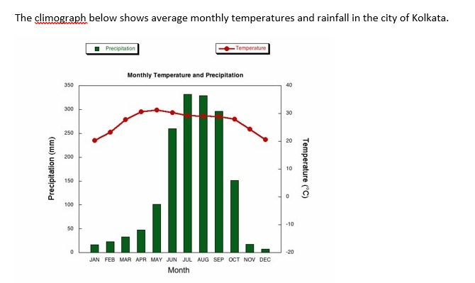

# 02 温度降水(混合图:柱形 + 折线,双纵轴)

- 题型:混合图(Task 1,气候图 climograph:12 个月的降水柱形 + 气温折线,**两根纵轴,单位不同**)
- 来源:`小作文/混合图/温度降水.docx`
- 首次学习:2026-11-25
- 原图:`../question/02.png`(已对照)

## 题目

The climograph below shows average monthly temperatures and rainfall in the city of Kolkata.



### 先看清这张图(双纵轴)

- **柱形(绿色)= Precipitation(降水量),看左边的纵轴**,单位 **mm**,0–350。
- **折线(红色)= Temperature(气温),看右边的纵轴**,单位 **°C**,−20–40。
- 两个数据的单位不同,读数时要**先确认看哪根轴**,写数字时要带上单位(`mm`、`°C`)。
- 横轴是一年里的 12 个月(JAN–DEC),没有具体年份。

### 读图数据(我的近似读数)

降水量误差约 ±5 mm,气温误差约 ±1–2 °C(10–11 月的气温不太确定)。

| 月份 | 降水量(mm) | 气温(°C) |
| --- | --- | --- |
| JAN | 约 15 | 约 20 |
| FEB | 约 22 | 约 23 |
| MAR | 约 32 | 约 28 |
| APR | 约 47 | 约 31 |
| MAY | 约 100 | 约 32 |
| JUN | 约 260 | 约 30 |
| JUL | 约 332 | 约 29 |
| AUG | 约 328 | 约 29 |
| SEP | 约 297 | 约 28 |
| OCT | 约 152 | 约 27 |
| NOV | 约 17 | 约 24 |
| DEC | 约 7 | 约 20 |

> 全年降水变化很大(不到 10 mm 到 330 mm 以上),气温变化不大(约 20–32 °C)。

## 原范文

The chart compares average figures for temperature and precipitation over the course of a calendar year in Kolkata.

It is noticeable that monthly figures for precipitation in Kolkata vary considerably, whereas monthly temperatures remain relatively stable. Rainfall is highest from July to August, while temperatures are highest in April and May.

Between the months of January and May, average temperatures in Kolkata rise from their lowest point at around 20°C to a peak of just over 30°C. Average rainfall in the city also rises over the same period, from approximately 20mm of rain in January to 100mm in May.

While temperatures stay roughly the same for the next four months, the amount of rainfall is more than doubles between May and June. Figures for precipitation remain above 250mm from June to September, peaking at around 330mm in July. The final three months of the year see a dramatic fall in precipitation, to a low of about 10mm in December, and a steady drop in temperatures back to the January average.

### 对照原图后的核对结果

| 范文里的说法 | 与图是否一致 |
| --- | --- |
| 降水变化很大,气温相对稳定 | 一致(降水约 7–332 mm;气温约 20–32 °C) |
| 降水 7、8 月最高 | 一致(约 332、328 mm) |
| 气温 4、5 月最高 | 一致(约 31、32 °C) |
| 1–5 月气温从约 20 °C 升到略高于 30 °C | 一致 |
| 1 月降水 `approximately 20mm`,5 月 100mm | **略偏大**:1 月约 15 mm;5 月约 100 mm 一致 |
| 之后四个月气温大致不变 | 基本一致(约 32 → 28 °C,略降) |
| 5 月到 6 月降水增加一倍多 | 一致(约 100 → 260 mm,2.6 倍) |
| 6–9 月降水都高于 250 mm,7 月约 330 mm | 一致 |
| 年底三个月降水大幅下降,12 月 `about 10mm` | 基本一致(12 月约 7 mm,写 `under 10mm` 更准) |
| 年底气温下降,回到 1 月水平 | 一致(约 20 °C) |
| `the amount of rainfall is more than doubles` | **语法笔误**:多了 `is`,应为 `the amount of rainfall more than doubles` |

数据基本正确,有一处语法笔误。

## 参考修改版(Claude)

The climograph compares average figures for temperature and precipitation over the course of a calendar year in Kolkata.

It is noticeable that monthly figures for precipitation in Kolkata vary considerably, from under 10mm to over 300mm, whereas monthly temperatures remain relatively stable, between about 20°C and 32°C. Rainfall is highest in July and August, while temperatures are highest in April and May.

Between the months of January and May, average temperatures in Kolkata rise from their lowest point at around 20°C to a peak of just over 30°C. Average rainfall in the city also rises over the same period, from about 15mm of rain in January to 100mm in May.

While temperatures stay roughly the same for the next four months, the amount of rainfall more than doubles between May and June. Figures for precipitation remain above 250mm from June to September, peaking at around 330mm in July. The final three months of the year see a dramatic fall in precipitation, to a low of under 10mm in December, and a steady drop in temperatures back to the January average.

### 修改说明

| 位置 | 原文 | 修改 | 原因 |
| --- | --- | --- | --- |
| 开头 | The chart | The climograph | 与题目一致 |
| 概述 | vary considerably … remain relatively stable | …from under 10mm to over 300mm …between about 20°C and 32°C | 用数字说明「变化大」和「稳定」 |
| 概述 | highest from July to August | highest in July and August | 更简洁 |
| 数据 | approximately 20mm in January | about 15mm | 读图约 15 mm |
| 语法 | the amount of rainfall **is** more than doubles | the amount of rainfall more than doubles | 多了 is |
| 数据 | a low of about 10mm | a low of under 10mm | 读图约 7 mm |

## 这篇值得学的地方

**1. 双纵轴:先确认看哪根轴**
- 降水(柱形)→ 左轴(mm)。
- 气温(折线)→ 右轴(°C)。
- 如果把折线的位置读到左轴上,会得到约 230(mm),完全是错的。读数前先问:这个数据看哪根轴?

**2. 气候图的结构**
- **概述:** 降水变化大,气温稳定;降水最高的月份,气温最高的月份。
- **按时间(季节)分段:**
  - 1–5 月:气温上升到全年最高,降水还很少(旱季到热季)。
  - 6–9 月:降水猛增,超过 250 mm,气温略降(雨季)。
  - 10–12 月:降水大幅下降,气温回到 1 月水平。

**3. 没有年份 → 一般现在时**
这是「典型一年里每个月的平均值」,没有具体年份,用一般现在时:`rise`、`remain`、`stay`、`vary`、`peak`。和饼图 01、表格 01 一样。

**4. 同义词**

| 意思 | 说法 |
| --- | --- |
| 降水 | precipitation / rainfall / the amount of rain |
| 气温 | temperature / average temperature |
| 稳定 | remain relatively stable / stay roughly the same |
| 变化大 | vary considerably / fluctuate widely |
| 峰值 | a peak of just over 30°C / peaking at around 330mm |
| 最低点 | their lowest point / a low of under 10mm |

**5. 单位的写法**
`20°C`、`250mm`、`330mm`。数字后面带单位,不要漏。

**6. 倍数和变化幅度**
`more than doubles`(100 → 260 mm,是 2.6 倍)。`a dramatic fall`、`a steady drop`、`a sharp rise`。

**7. 估读用近似词**
`around 20°C`、`just over 30°C`、`approximately 20mm`、`about 10mm`、`over 300mm`、`under 10mm`。

**8. 值得抄的句型(介词练习)**

| 句型 | 说明 |
| --- | --- |
| monthly figures **for** precipitation **in** Kolkata vary considerably | figures **for**;**in** + 城市 |
| Rainfall is highest **from** July **to** August / **in** April and May | from … to;in + 月份 |
| **Between** the months **of** January **and** May, … rise **from** their lowest point **at** around 20°C **to** a peak **of** just over 30°C | between … and;from … at …to;a peak **of** |
| rises **over** the same period, **from** approximately 20mm **of** rain **in** January **to** 100mm **in** May | over the same period;mm **of** rain |
| the amount of rainfall more than doubles **between** May **and** June | between … and |
| remain **above** 250mm **from** June **to** September, peaking **at** around 330mm **in** July | remain **above**;peaking **at** |
| a dramatic fall **in** precipitation, **to** a low **of** about 10mm **in** December | a fall **in**;**to** a low **of** |
| a steady drop **in** temperatures **back to** the January average | drop **in**;back **to** |

**9. 混合图 01 和 02 对比**

| | 混合图 01 英国移民 | 混合图 02 温度降水 |
| --- | --- | --- |
| 图形 | 折线 + 柱形 | 折线 + 柱形 |
| 纵轴 | **同一根轴**(thousands) | **两根轴**(mm、°C) |
| 数据关系 | 净移民 = 迁入 − 迁出 | 气温和降水是两个独立的数据 |
| 时态 | 有年份 → 过去时 | **没有年份 → 现在时** |
| 分段 | 按时间(年份) | 按时间(月份 / 季节) |
| 重点 | 三个系列的标签 | **两根轴的单位** |

---

## 版本 1:我的初稿(待写)

> 建议先不要看上面的修改版,只看题目和原图,限时 20 分钟写一版。写之前先在草稿纸上做三件事:① 列一张小表:月份 | 降水(mm)| 气温(°C),并标明哪个数据看哪根轴;② 找出降水最高和最低的月份、气温最高和最低的月份;③ 把全年按季节分成三段。写完后原样贴在下面,不要事后改动,先对照 `error-log.md` 的「高频五条」过一遍,再发给我批改。

```text

```

### 写作时重点盯住的几点

1. **开头句:** 先圈出主语和动词(The climograph compares / shows)。
2. **单位:** 降水 mm,气温 °C;读数前先确认看哪根轴。
3. **时态:** 没有年份 → 一般现在时(rise、remain、peak、fall)。
4. **概述:** 降水变化大,气温稳定;写出最高月份。
5. **变化词和介词:** rise **from** … **to**、a peak **of**、peaking **at**、remain **above**、a fall **in**、**between** … **and**、**in** July。
6. **主语:** 变化的是 temperatures / rainfall / the amount of rain,不是 Kolkata。
7. **写完圈出每个动词;拼写;每段用句号收尾;逗号不连接分句。**