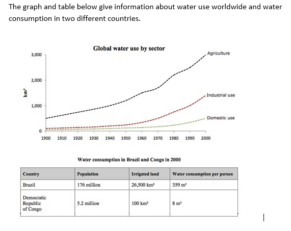

# 03 水消耗(混合图:折线图 + 表格)

- 题型:混合图(Task 1,一张折线图 + 一张表格,两个不同的数据来源)
- 来源:`小作文/混合图/水消耗.docx`
- 首次学习:2026-11-26
- 原图:`../question/03.png`(已对照)

## 题目

The graph and table below give information about water use worldwide and water consumption in two different countries.



### 先看清这两部分

- **折线图(上):** 1900–2000 年全球用水量,按用途分三条线:Agriculture(农业)、Industrial use(工业)、Domestic use(生活)。纵轴单位 **km³**(立方公里)。
- **表格(下):** 2000 年巴西和刚果民主共和国的用水情况,三列:人口(million)、灌溉土地(**km²**,平方公里)、人均用水量(**m³**,立方米)。
- **注意单位的上标:** `km³` 是体积(水量),`km²` 是面积(土地),`m³` 是立方米。写作时要照着图写,不能混。

### 读图数据(我的近似读数)

**折线图**(单位 km³,误差约 ±100):

| 年份 | Agriculture | Industrial | Domestic |
| --- | --- | --- | --- |
| 1900 | 约 500 | 约 100 | 约 100 |
| 1950 | 约 1,200 | 约 230 | 约 130 |
| 2000 | 约 3,000 | 约 1,400 | 约 500 |

> 三条线都一直上升。农业始终最高;工业和生活用水在 1950 年以前都很低,**1950 年以后工业用水明显加速**。

**表格**(精确数字):

| Country | Population | Irrigated land | Water consumption per person |
| --- | --- | --- | --- |
| Brazil | 176 million | 26,500 km² | 359 m³ |
| Democratic Republic of Congo | 5.2 million | 100 km² | 8 m³ |

## 原范文

The charts compare the amount of water used for agriculture, industry and homes around the world, and water use in Brazil and the Democratic Republic of Congo.

It is clear that global water needs rose significantly between 1900 and 2000, and that agriculture accounted for the largest proportion of water used. We can also see that water consumption was considerably higher in Brazil than in the Congo.

In 1900, around 500km³ of water was used by the agriculture sector worldwide. The figures for industrial and domestic water consumption stood at around one fifth of that amount. By 2000, global water use for agriculture had increased to around 3000km³, industrial water use had risen to just under half that amount, and domestic consumption had reached approximately 500km³.

In the year 2000, the populations of Brazil and the Congo were 176 million and 5.2 million respectively. Water consumption per person in Brazil, at 359m³, was much higher than that in the Congo, at only 8m³, and this could be explained by the fact that Brazil had 265 times more irrigated land.

### 对照原图后的核对结果

| 范文里的说法 | 与图 / 表是否一致 |
| --- | --- |
| 1900–2000 年全球用水大幅上升,农业占比最大 | 一致 |
| 1900 年农业约 500 km³ | 一致 |
| 1900 年工业和生活用水约为农业的五分之一 | 一致(约 100) |
| 2000 年农业约 3,000 km³ | 一致 |
| 2000 年工业用水 just under half that amount | 一致(约 1,400,略低于 1,500) |
| 2000 年生活用水约 500 km³ | 一致 |
| 巴西、刚果人口 176 百万、5.2 百万 | 一致 |
| 人均用水量 359 m³ 对 8 m³ | 一致 |
| 巴西灌溉土地是刚果的 265 倍 | 一致(26,500 ÷ 100 = 265) |
| `this could be explained by the fact that …` | **推断**:图表没有给出因果关系,范文用 could 做了保留,但更稳妥的写法是只陈述事实 |
| 概述 `water consumption was considerably higher in Brazil` | **不够准确**:表里是**人均**用水量,应写 `per person` |
| 工业用水增长最快(约 1,00 → 1,400) | **范文没写**:按倍数,工业增长最快(约 14 倍),农业增长最多(增加约 2,500) |

数据全部正确。**没有写的:** 工业用水按比例增长最快;概述里「人均」没说清。

## 参考修改版(Claude)

The charts compare the amount of water used for agriculture, industry and homes around the world, and water use in Brazil and the Democratic Republic of Congo.

It is clear that global water use rose significantly between 1900 and 2000, and that agriculture accounted for the largest proportion of the water used. It is also clear that water consumption per person was considerably higher in Brazil than in the Congo.

In 1900, around 500km³ of water was used by the agriculture sector worldwide. The figures for industrial and domestic water consumption stood at around one fifth of that amount. By 2000, global water use for agriculture had increased to around 3,000km³, industrial water use had risen to just under half that amount, and domestic consumption had reached approximately 500km³. In proportional terms, industrial use grew fastest, increasing more than tenfold. [核对原图]

In 2000, the populations of Brazil and the Congo were 176 million and 5.2 million respectively. Water consumption per person in Brazil, at 359m³, was about 45 times that in the Congo, at only 8m³. Brazil also had far more irrigated land, at 26,500km² compared with only 100km² in the Congo.

### 修改说明

| 位置 | 原文 | 修改 | 原因 |
| --- | --- | --- | --- |
| 概述 | water consumption was considerably higher in Brazil | water consumption **per person** was considerably higher in Brazil | 表里是人均用水量 |
| 概述 | global water needs | global water use | 与图的标题一致(Global water use) |
| 第 3 段 | (没有) | In proportional terms, industrial use grew fastest, increasing more than tenfold | 工业用水从约 100 升到约 1,400,约 14 倍;农业只有约 6 倍 [核对原图] |
| 第 4 段 | much higher than that in the Congo | about 45 times that in the Congo | 359 ÷ 8 ≈ 45,把「高得多」具体化 |
| 第 4 段 | this could be explained by the fact that Brazil had 265 times more irrigated land | Brazil also had far more irrigated land, at 26,500km² compared with only 100km² | 图表没有给出因果关系,只陈述事实 |
| 第 4 段 | In the year 2000 | In 2000 | the year 多余 |
| 数字格式 | 3000km³ | 3,000km³ | 千位逗号 |

## 这篇值得学的地方

**1. 折线图 + 表格:两个数据来源,两个主体段**
- 第 3 段写折线图(全球用水,1900 到 2000)。
- 第 4 段写表格(2000 年的巴西和刚果)。
- 概述各写一点:全球用水大幅上升、农业最大;人均用水量巴西远高于刚果。

**2. 单位:km³、km²、m³ 要分清**

| 单位 | 含义 | 用在 |
| --- | --- | --- |
| km³ | 立方公里(体积) | 全球用水量 |
| km² | 平方公里(面积) | 灌溉土地 |
| m³ | 立方米(体积) | 人均用水量 |

**3. 折线图的写法**
- 按时间写起点和终点(1900 年、2000 年)。
- 比较三条线:农业最大;工业和生活用水都从很低的水平上升。
- **按比例看,工业增长最快;按绝对量看,农业增加最多。** 两种角度结论不同,写的时候要说清楚是哪一种(`in proportional terms`)。

**4. 倍数和分数**

| 数据 | 说法 |
| --- | --- |
| 100 对 500 | one fifth of that amount |
| 1,400 对 3,000 | just under half that amount |
| 100 → 1,400 | rose about fourteenfold / more than tenfold |
| 26,500 对 100 | 265 times as much / far more irrigated land |
| 359 对 8 | about 45 times that in the Congo |

**5. 表格:只陈述事实,不写因果**
`this could be explained by …` 是推断。图表只给了数据,没有说明原因。Task 1 写事实就够了。

**6. 时态**
1900–2000 和 2000 年都是过去的年份,用过去时。`By 2000, … had increased to …` 用过去完成时也可以;不确定时,可以写一般过去时:`By 2000, global water use for agriculture was around 3,000km³`。

**7. 值得抄的句型(介词练习)**

| 句型 | 说明 |
| --- | --- |
| the amount of water used **for** agriculture, industry and homes **around** the world | used **for**;around the world |
| agriculture **accounted for** the largest proportion **of** water used | account **for**;proportion **of** |
| The figures **for** industrial and domestic water consumption **stood at** around one fifth **of** that amount | the figures for;stood at;one fifth of |
| **By** 2000, … had increased **to** around 3,000km³ | By + 年份;increased to |
| industrial water use had risen **to** just under half that amount | risen to;half that amount |
| domestic consumption had reached approximately 500km³ | reach 后面不加 to |
| the populations of Brazil and the Congo were 176 million and 5.2 million **respectively** | respectively |
| Water consumption **per person** in Brazil, **at** 359m³, was much higher than **that in** the Congo | per person;at + 数值;that in |

**8. 国家名**
`Brazil`(不加 the)、`the Democratic Republic of Congo`、`the Congo`(要加 the)。

**9. 三篇混合图对比**

| | 混合图 01 英国移民 | 混合图 02 温度降水 | 混合图 03 水消耗 |
| --- | --- | --- | --- |
| 组合 | 折线 + 柱形 | 柱形 + 折线(双纵轴) | **折线图 + 表格** |
| 数据来源 | 一个图 | 一个图 | **两个独立的数据** |
| 时态 | 过去时(有年份) | 现在时(无年份) | 过去时(有年份) |
| 分段 | 按年份 | 按月份(季节) | **一图一段** |
| 重点 | 三个系列的标签 | 两根轴的单位 | **单位(km³ / km² / m³)、倍数** |

---

## 版本 1:我的初稿(待写)

> 建议先不要看上面的修改版,只看题目和原图,限时 20 分钟写一版。写之前先在草稿纸上做三件事:① 写下折线图三条线在 1900 和 2000 年的数值(单位 km³);② 写下表格的数据和单位(million、km²、m³);③ 算出倍数(土地 26,500 ÷ 100,人均用水 359 ÷ 8)。写完后原样贴在下面,不要事后改动,先对照 `error-log.md` 的「高频五条」过一遍,再发给我批改。

```text

```

### 写作时重点盯住的几点

1. **开头句:** 同时概括折线图和表格;先圈出主语和动词。
2. **概述:** 折线图一点、表格一点(注意 per person)。
3. **单位:** km³、km²、m³ 照图写;大数加千位逗号。
4. **倍数 / 分数:** one fifth、just under half、265 times、about 45 times;先算再写。
5. **只陈述事实:** 不写「could be explained by」。
6. **介词:** used **for** agriculture、accounted **for**、stood **at**、increased **to**、**By** 2000、**per** person、**at** 359m³、**that in** the Congo。
7. **过去时(写完圈出每个动词);主语是 water use / consumption,不是 agriculture / Brazil(Brazil's consumption);拼写;每段用句号收尾。**