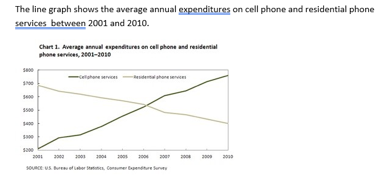

# 01 手机变迁(线图)

- 题型:线图(Task 1,两条线,10 个年份,有交叉点)
- 来源:`小作文/线图/手机变迁.docx`
- 首次学习:2026-11-16
- 原图:`../question/01.png`(已对照)

## 题目

The line graph shows the average annual expenditures on cell phone and residential phone services between 2001 and 2010.



### 读图数据(我的近似读数)

单位:美元。线图要估读,误差约 ±15。

| 年份 | Cell phone services | Residential phone services |
| --- | --- | --- |
| 2001 | 约 210 | 约 685 |
| 2002 | 约 290 | 约 640 |
| 2003 | 约 315 | 约 620 |
| 2004 | 约 380 | 约 590 |
| 2005 | 约 455 | 约 570 |
| 2006 | 约 525 | 约 540 |
| 2007 | 约 605 | 约 480 |
| 2008 | 约 645 | 约 465 |
| 2009 | 约 715 | 约 430 |
| 2010 | 约 760 | 约 400 |

> 两条线在 **2006 年**附近相交(都约 $530),这是整张图最重要的点。

## 原范文

The line graph compares average yearly spending by Americans on mobile and landline phone services from 2001 to 2010.

It is clear that spending on landline phones fell steadily over the 10-year period, while mobile phone expenditure rose quickly. The year 2006 marks the point at which expenditure on mobile services overtook that for residential phone services.

In 2001, US consumers spent an average of nearly $700 on residential phone services, compared to only around $200 on cell phone services. Over the following five years, average yearly spending on landlines dropped by nearly $200. By contrast, expenditure on mobiles rose by approximately $300.

In the year 2006, the average American paid out the same amount of money on both types of phone service, spending just over $500 on each. By 2010, expenditure on mobile phones had reached around $750, while the figure for spending on residential services had fallen to just over half this amount.

### 对照原图后的核对结果

| 范文里的说法 | 与图是否一致 |
| --- | --- |
| 2001 年座机 nearly $700,手机 around $200 | 一致(约 685、210) |
| 座机在整个时期稳步下降 | 一致 |
| 手机快速上升 | 一致 |
| 2006 年是手机超过座机的转折点 | 一致(两线在 2006 年附近相交) |
| 前五年座机下降 `nearly $200` | **偏大**:约 685 → 540,下降约 $145,写 `about $150` 更准 |
| 前五年手机上升 `approximately $300` | 一致(约 210 → 525) |
| 2006 年两者相同,都 just over $500 | 基本一致(交叉点约 $525–540) |
| 2010 年手机 around $750 | 一致(约 760) |
| 2010 年座机 just over half this amount | 一致(400 ÷ 760 ≈ 0.53) |

数据基本正确,只有「下降 nearly $200」偏大。

## 参考修改版(Claude)

The line graph compares average yearly spending by Americans on mobile and landline phone services from 2001 to 2010.

It is clear that spending on landline phones fell steadily over the 10-year period, while mobile phone expenditure rose quickly. The year 2006 marks the point at which expenditure on mobile services overtook that for residential phone services.

In 2001, US consumers spent an average of nearly $700 on residential phone services, compared to only around $200 on cell phone services. Over the following five years, average yearly spending on landlines dropped by about $150, while expenditure on mobiles rose by approximately $300.

In 2006, the average American paid out the same amount of money on both types of phone service, spending just over $500 on each. By 2010, expenditure on mobile phones had reached around $750, while spending on residential services had fallen to around $400, just over half that amount.

### 修改说明

| 位置 | 原文 | 修改 | 原因 |
| --- | --- | --- | --- |
| 数据 | dropped by nearly $200 | dropped by about $150 | 读图约 685 → 540,下降约 145 |
| 合并 | …dropped by nearly $200. By contrast, expenditure on mobiles rose by approximately $300. | …dropped by about $150, while expenditure on mobiles rose by approximately $300. | 一句话写出两条线的相反变化 |
| 年份 | In the year 2006 | In 2006 | the year 多余 |
| 数据 | fallen to just over half this amount | fallen to around $400, just over half that amount | 补出具体数值 $400 |

这篇范文写得很好,结构清楚,只有一个数据偏大。

## 这篇值得学的地方

**1. 线图的写法:趋势 + 交叉点 + 起点终点**
不要逐年报数。两条线的这张图只需要:
- **整体趋势:** 座机稳步下降,手机快速上升。
- **交叉点:** 2006 年两线相交(`overtook`)。
- **起点和终点的数值:** 2001 年(约 700 对 200)、2010 年(约 750 对 400)。

**2. 分段:按交叉点分两个阶段**
- 第 3 段:2001–2006(起点到交叉点)。
- 第 4 段:2006–2010(交叉点到终点)。

**3. 两条线方向相反,用对比句式**
`while`、`By contrast`、`whereas`、`compared to`。

**4. 趋势动词和幅度:by 写幅度,to 写终点**

| 写法 | 例子 |
| --- | --- |
| rose / dropped **by** 300 | rose by approximately $300 |
| rose / fell **to** 750 | fell to just over half that amount |
| rose **from** 200 **to** 500 | |
| reached around $750 | reach 后面不加 to |
| 副词 | fell **steadily**、rose **quickly**、dropped **slightly** |

动词:rise / climb / grow / increase;fall / drop / decline / decrease。

**5. 交叉点怎么写**
- `The year 2006 marks the point at which expenditure on mobile services overtook that for residential phone services.`
- `In 2006, the two figures were equal, at just over $500.`
- `Mobile phone spending overtook landline spending in 2006.`

**6. 线图要估读,所以要用近似词**
`nearly $700`、`around $200`、`just over $500`、`approximately $300`、`about $150`。与表格(精确数字)不同。

**7. 同义词**
- cell phone = mobile phone;residential phone = landline。
- expenditure = spending = money paid out;average annual = average yearly。

**8. 时态**
2001–2010 是具体年份,用过去时(spent、dropped、rose、paid out)。`By 2010, … had reached` 用过去完成时也可以;不确定时,用一般过去时更安全:`In 2010, expenditure on mobile phones reached around $750`。

**9. 值得抄的句型(介词练习)**

| 句型 | 说明 |
| --- | --- |
| spending **on** landline phones fell steadily **over** the 10-year period | spending **on**;**over** the period |
| expenditure on mobile services overtook **that for** residential phone services | that **for** + 项目(数据属于谁) |
| spent an average **of** nearly $700 **on** residential phone services, **compared to** only around $200 | an average of;compared to |
| dropped **by** about $150 | by + 幅度 |
| paid out the same amount of money **on** both types of phone service, spending just over $500 **on** each | spend … on each |
| had fallen **to** around $400, just over half **that amount** | to + 终点 |
| **from** 2001 **to** 2010 / **between** 2001 **and** 2010 | 时间范围 |
| **In** 2006 / **By** 2010 | in + 年份;by + 年份 |

**10. 与前面题型对比**

| | 柱图 | 表格 | 线图 |
| --- | --- | --- | --- |
| 数字 | 估读 | 精确 | 估读 |
| 近似词 | 用 | 一般不用 | **用** |
| 重点 | 对比、交叉点 | 排名、分组 | **趋势、交叉点、起点终点** |
| 时态 | 看年份 | 看年份 | 看年份(这篇过去时) |

---

## 版本 1:我的初稿(2026-11-16,原样保留,不改动)

```text
It is clear that the spending on residential phone fell steadly over ten years, while that on mobile phone rose quickly. The 2006 marked startup that the mobile service overtook residential service.

In 2001, American comsumers spent average nearly $700 on residential phone service, while that on mobile phone service was only around $200.Over the next five years, the average spending yearly on residentail phone recude around $150 , while that on mobile phone rose aound $300.

In 2006, the Americian spent the same average amount on the two phone service,each was just over $500. Then 2000,the spending on phone reached around $750, while that on residentail service fell to around $400, just over half than the total.
```

> 说明:这一份的内容点和「参考修改版」几乎一一对应(包括交叉点),但句子是你自己组织的,语言错误是真实的。**没有开头句**:全文只有三段,第一段就是概述。

### 逐句批改

**缺少:开头句**

线图和其他题型一样,要有一句话改写题目,再写概述。参考:

> The line graph compares average yearly spending by Americans on mobile and landline phone services from 2001 to 2010.

**第 1 段(概述)**

| 问题 | 类型 | 改正 |
| --- | --- | --- |
| the spending on **residential phone** fell **steadly** over **ten years** | 单复数;拼写;over the ten-year period | spending on residential phone **services** fell **steadily** over the **ten-year period** |
| while **that on mobile phone** rose quickly | ✓ that on 用对了(spending 不可数);mobile phone 应为复数 | while that on mobile phone **services** rose quickly |
| **The 2006 marked startup that** the mobile service overtook … | 不通;`startup` 的意思是「开始」,这里是「转折点」;缺 the year | **The year 2006 marks the point at which** … |
| **the mobile service overtook** residential service | **主语错误:超过的是「花费」,不是 service**;比较对象要同类 | spending on mobile services overtook **that on** residential services |

> 改正:It is clear that spending on residential phone services fell steadily over the ten-year period, while that on mobile phone services rose quickly. The year 2006 marks the point at which spending on mobile services overtook that on residential services.

**第 2 段(2001–2006)**

| 问题 | 类型 | 改正 |
| --- | --- | --- |
| **comsumers** | 拼写(柱图 07 里也拼错过) | consumers |
| spent **average nearly** $700 | 漏 an、of | spent **an average of** nearly $700 |
| residential phone **service** | 复数 | services |
| while that on mobile phone service was only around $200 | ✓ that on 用对了 | |
| the **average spending yearly** on **residentail** phone **recude around** $150 | 语序;拼写;**reduce 不能这样用**;**漏 by** | the **average yearly spending** on residential phones **fell by around** $150 |
| that on mobile phone rose **aound** $300 | 拼写;**漏 by** | that on mobile phones rose **by around** $300 |

> 改正:In 2001, American consumers spent an average of nearly $700 on residential phone services, while that on mobile phone services was only around $200. Over the next five years, the average yearly spending on residential phones fell by around $150, while that on mobile phones rose by around $300.

`Over the next five years` 用对了,`that on` 也用对了。

**第 3 段(2006–2010)**

| 问题 | 类型 | 改正 |
| --- | --- | --- |
| the **Americian** spent the same **average** amount on the two phone **service** | 拼写;the average American 才是「普通美国人」;services | **the average American** spent the same amount on **both types of phone service** |
| ,**each was** just over $500 | 逗号连接两个分句 | , at just over $500 each |
| **Then 2000** | **内容错误:应为 2010**(图的范围是 2001–2010);缺介词 | **In 2010** |
| the spending on **phone** reached around $750 | phone 指哪种?要写 mobile phones | spending on **mobile phones** reached around $750 |
| just over half **than the total** | **than → that amount**;`the total` 的意思错了:座机是手机的一半多,不是「总数」的一半多 | just over half **that amount** |

> 改正:In 2006, the average American spent the same amount on both types of phone service, at just over $500 each. In 2010, spending on mobile phones reached around $750, while that on residential services fell to around $400, just over half that amount.

`fell to around $400`、`reached around $750` 的 to 用对了(reach 后面不加 to)。

### 最小修订(保留你的思路,只改错)

The line graph compares average yearly spending by Americans on mobile and landline phone services from 2001 to 2010.

It is clear that spending on residential phone services fell steadily over the ten-year period, while that on mobile phone services rose quickly. The year 2006 marks the point at which spending on mobile services overtook that on residential services.

In 2001, American consumers spent an average of nearly $700 on residential phone services, while that on mobile phone services was only around $200. Over the next five years, the average yearly spending on residential phones fell by around $150, while that on mobile phones rose by around $300.

In 2006, the average American spent the same amount on both types of phone service, at just over $500 each. In 2010, spending on mobile phones reached around $750, while that on residential services fell to around $400, just over half that amount.

### 做得好的地方

- **时态:全篇过去时,没有错误。** 圈动词的办法继续有效。
- **`that on` 用对了 4 处:** spending 是不可数名词,用 that(前几篇一直在改的 that of / those of)。
- **`fell to around $400`、`reached around $750`:** to 和 reach 的用法都对,没有写 reach to。
- **`Over the next five years`、`In 2006`、`In 2001`** 这些时间介词都对。
- **估读用对了近似词:** nearly、around、just over。
- **抓到了交叉点:** 2006 年,以及「2006 年两者相同」。
- **没有缺句号**,数据除了年份外全部正确。
- 副词用对了:`fell steadily`(拼写有误)、`rose quickly`。

这份的内容点和修改版几乎一一对应,但句子是你自己组织的。

### 本篇的介词和搭配(对照 `grammer.md`)

| 你写的 | 正确 | 规则 |
| --- | --- | --- |
| spent **average** nearly $700 | spent **an average of** nearly $700 | an average **of** |
| **recude** around $150 | fell **by** around $150 | fell / rose / dropped + **by** + 幅度 |
| rose **aound** $300 | rose **by** around $300 | 同上(第 3 次漏 by) |
| **Then** 2000 | **In** 2010 | in + 年份 |
| half **than** the total | half **that amount** | half **of** / half that amount(表格 05 里也错过) |
| the two phone **service** | both types of phone **service** | |
| the point **that** … | the point **at which** … | |
| Over the next five years | ✓ 对了 | |
| fell **to** around $400 | ✓ 对了 | |
| In 2006 / In 2001 | ✓ 对了 | |

### 语法笔记

**1. 开头句不能省略**
线图的结构也是四段:开头句 + 概述 + 两个主体段。开头句是对题目的改写:`The line graph compares / shows … from 2001 to 2010.`。

**2. the point at which**
`The year 2006 marks the point at which spending on mobile services overtook that on residential services.`
✗ `The 2006 marked startup that …`(`startup` 是「开始」,这里要的是「转折点」)。

**3. 超过的是「花费」,不是 service**
✗ `the mobile service overtook residential service`
✓ `spending on mobile services overtook that on residential services`

**4. an average of**
`spent an average of nearly $700`。✗ `spent average nearly $700`。(an average of 是固定搭配,范文里就是这个写法)

**5. fell / rose + by + 幅度,这是第 3 次漏 by**

| 写法 | 例子 |
| --- | --- |
| ✓ | fell **by** around $150;rose **by** around $300 |
| ✗ | recude around $150;rose aound $300(08 里的 rose about $4 billion 同类) |

**6. reduce 是及物动词**
`reduce` 后面要接宾语:`Korea reduced its waste output`。表示「下降」用 `fell / dropped`,不用 reduce(表格 02 里的 `waste production reduce` 同类)。

**7. half 的写法**
`just over half that amount`(or `just over half of that amount`)。✗ `half than the total`(表格 05 里的 `half than total` 同类)。`the total` 的意思也不对。

**8. 年份写完回图核对**
`Then 2000`:图的范围是 2001–2010,2000 年不存在。写年份时,看一眼图的横轴。

**9. 复用句式时,把关键信息改对**
`the average American paid out the same amount …` 里 average 是 American 的修饰语,表示「普通美国人」。写成 `the same average amount` 意思就变了。

### 版本 1 对比笔记

**比表格 06 的版本 1 进步的地方**
- 时态错误 0 处。
- 缺句号 0 处。
- that on 用对 4 处;by / to / reach 的用法大多对。
- 内容错误只有 2 处(年份、`the total`),比表格 06 的 3 处少。

**又出现的老问题**
- **漏 by**(第 3 次):`rose aound $300`。
- **reduce 不及物**(表格 02)。
- **half than**(表格 05)。
- **拼写手误:** comsumer(柱图 07 也拼错过)、steadly、residentail ×2、recude、aound、Americian。
- **单复数:** 约 8 处(residential phone、mobile phone、service)。

**新出现的问题**
- **没有开头句。**
- `The 2006 marked startup that` 不通。
- `Then 2000`(年份写错)。
- `the total`(意思错了)。

---

## 版本 2:隔几天后重写(待写)

> 不看上面的任何内容,只看题目和原图,限时 20 分钟。

```text

```

### 写版本 2 时重点盯住的几点

1. **四段结构:** 开头句 + 概述 + 两个主体段,不要省略开头句。
2. **by 写幅度:** fell **by** around $150;rose **by** around $300。
3. **主语:** spending on mobile services overtook that on residential services。
4. **an average of;the point at which;half that amount。**
5. **年份回图核对;过去时(写完圈出每个动词);拼写。**
6. **单复数:** phones、services。