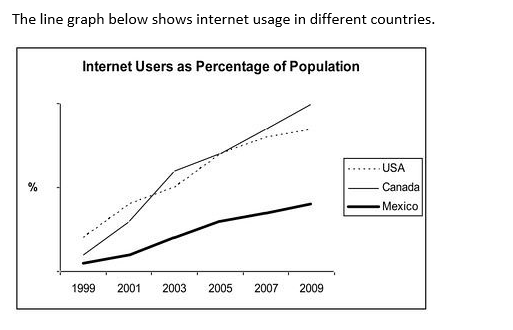

# 02 网络使用(线图)

- 题型:线图(Task 1,三条线,6 个年份,有交叉点,**纵轴没有数字**)
- 来源:`小作文/线图/网络使用.docx`
- 首次学习:2026-11-17
- 原图:`../question/02.png`(已对照)

## 题目

The line graph below shows internet usage in different countries.



### 先看清这张图

- 三条线:USA(虚线)、Canada(细实线)、Mexico(粗实线);横轴 1999、2001、…、2009。
- **纵轴只有 `%` 的标签和两个刻度线,没有数字。** 所以图上读不出精确数值,只能看相对位置和趋势。

### 读图数据(我的近似读数,**基于一个假设**)

假设纵轴基线是 0%,两个刻度线分别是 **50% 和 100%**。按这个假设读出的数字,和范文里的数字吻合(1999 年美国约 20%、2005 年约 70%、2009 年加拿大接近 100%)。**图上没有标注,这只是推断,请你对照原题确认。** 误差约 ±5。

| 年份 | USA | Canada | Mexico |
| --- | --- | --- | --- |
| 1999 | 约 20 | 约 10 | 约 5 |
| 2001 | 约 40 | 约 30 | 约 10 |
| 2003 | 约 50 | 约 62 | 约 20 |
| 2005 | 约 70 | 约 70 | 约 28 |
| 2007 | 约 80 | 约 85 | 约 33 |
| 2009 | 约 83 | 约 100 | 约 40 |

> 即使纵轴没有数字,下面这些**相对关系**是确定的:三个国家都上升;墨西哥始终最低;加拿大起点低于美国,2003 年超过美国,2005 年两线相交,之后加拿大继续上升,美国增长放缓。

## 原范文

The line graph compares the percentage of people in three countries who used the Internet between 1999 and 2009.

It is clear that the proportion of the population who used the Internet increased in each country over the period shown. Overall, a much larger percentage of Canadians and Americans had access to the Internet in comparison with Mexicans, and Canada experienced the fastest growth in Internet usage.

In 1999, the proportion of people using the Internet in the USA was about 20%. The figures for Canada and Mexico were lower, at about 10% and 5% respectively. In 2005, Internet usage in both the USA and Canada rose to around 70% of the population, while the figure for Mexico reached just over 25%.

By 2009, the percentage of Internet users was highest in Canada. Almost 100% of Canadians used the Internet, compared to about 80% of Americans and only 40% of Mexicans.

### 对照原图后的核对结果

| 范文里的说法 | 与图是否一致 |
| --- | --- |
| 每个国家的上网比例都上升 | 一致 |
| 加拿大和美国比墨西哥高得多 | 一致(墨西哥全程最低) |
| 加拿大增长最快 | 一致(约 10% → 100%,美国约 20% → 83%,墨西哥约 5% → 40%) |
| 1999 年美国约 20%,加拿大约 10%,墨西哥约 5% | 相对位置一致(美国最高,墨西哥最低);数值是按推断的刻度读的 |
| 2005 年美国和加拿大都约 70% | 一致(两条线在 2005 年相交) |
| 2005 年墨西哥 just over 25% | 基本一致(约 28%) |
| 2009 年加拿大 almost 100%,美国约 80%,墨西哥 40% | 基本一致(美国约 80%–85%) |
| 2003 年加拿大曾超过美国 | **范文没写** |
| 2005 年以后美国增长放缓 | **范文没写** |

范文从 1999 年直接跳到 2005 年,没有写**加拿大从落后追到领先**这个最有意思的变化,也没有写美国后期增长放缓。

## 参考修改版(Claude)

> 图上没有纵轴数字,下面的百分比是按范文的数字推断的 [核对原题]。

The line graph compares the percentage of people in three countries who used the Internet between 1999 and 2009.

It is clear that the proportion of the population who used the Internet increased in each country over the period shown. Overall, a much larger percentage of Canadians and Americans had access to the Internet in comparison with Mexicans, and Canada experienced the fastest growth in Internet usage.

In 1999, the proportion of people using the Internet in the USA was about 20%. The figures for Canada and Mexico were lower, at about 10% and 5% respectively. Canada's figure then grew faster than that of the USA, and by 2005 both countries had reached around 70% of the population, while the figure for Mexico was just over 25%.

By 2009, the percentage of Internet users was highest in Canada. Almost 100% of Canadians used the Internet, compared to about 80% of Americans and only 40% of Mexicans. Growth in the USA slowed after 2005, while Mexico's figure rose steadily throughout the period.

### 修改说明

| 位置 | 原文 | 修改 | 原因 |
| --- | --- | --- | --- |
| 第 3 段 | (没有) | Canada's figure then grew faster than that of the USA, and by 2005 both countries had reached around 70% | 补上加拿大从落后追到持平,这是图上最有意思的变化;`that of` 指代单数 figure |
| 第 3 段 | In 2005, … rose to around 70% …, while the figure for Mexico reached just over 25% | by 2005 both countries had reached around 70% …, while the figure for Mexico was just over 25% | 与上一句衔接;reach 在这里改成 was 更自然 |
| 第 4 段 | (没有) | Growth in the USA slowed after 2005, while Mexico's figure rose steadily | 补上美国增长放缓、墨西哥稳步上升 |

这篇范文结构清楚,数据没有明显错误,修改版补的是两个变化趋势。

## 这篇值得学的地方

**1. 纵轴没有数字怎么办**
考试里的线图通常有刻度数字,但如果遇到没有数字的图:
- 不能给出精确数值,只能写**相对关系**和**趋势**:`much higher than`、`about twice as high as`、`the lowest throughout`、`rose steadily`、`overtook`。
- 如果能合理推断刻度,可以用 `approximately`、`about` 配合近似数字,不要写得太精确。
- **你手里的原题纵轴如果有数字,请告诉我,我按数字重新核对。**

**2. 三条线的图:怎么写**
先趋势,再比较位置,再抓交叉点,最后写终点排名:
- 趋势:三个国家都上升。
- 位置:墨西哥全程最低;美国起点最高;加拿大增长最快。
- 交叉点:加拿大 2003 年超过美国,2005 年两线相交,之后加拿大继续领先。
- 终点(2009):加拿大 > 美国 > 墨西哥。

**3. 按时间分段**
有交叉的线图,按时间分段最清楚:1999(起点)→ 2005(中间,交叉)→ 2009(终点)。

**4. 描述增长的快慢**

| 说法 | 用在 |
| --- | --- |
| experienced the fastest growth | 加拿大 |
| rose steadily | 墨西哥 |
| growth slowed / levelled off after 2005 | 美国 |
| rose sharply / dramatically | 陡升的阶段 |
| caught up with / overtook | 追平 / 超过 |
| were level at around 70% | 持平 |

**5. 比较的写法**
- `a much larger percentage of Canadians and Americans … in comparison with Mexicans`
- `Almost 100% of Canadians used the Internet, compared to about 80% of Americans and only 40% of Mexicans`
- `Canada's figure grew faster than that of the USA`(figure 是单数,用 that of)

**6. 时态**
1999–2009 是具体年份,数据句用过去时(was、rose、reached、used)。

**7. 值得抄的句型(介词练习)**

| 句型 | 说明 |
| --- | --- |
| the proportion of the population **who** used the Internet increased **in** each country **over** the period shown | proportion **of**;**in** each country;**over** the period |
| a much larger percentage of Canadians … had access **to** the Internet **in comparison with** Mexicans | access **to**;in comparison **with** |
| Canada experienced the fastest growth **in** Internet usage | growth **in** + 事物 |
| the figures for Canada and Mexico were lower, **at** about 10% and 5% **respectively** | the figures **for**;at + 数值;respectively |
| Internet usage … rose **to** around 70% **of** the population | rose to + 终点;of the population |
| the figure for Mexico reached just over 25% | reach 后面不加 to |
| **By** 2009 … **compared to** about 80% of Americans | by + 年份;compared to |

**8. 两篇线图对比**

| | 线图 01 手机变迁 | 线图 02 网络使用 |
| --- | --- | --- |
| 线数 | 两条 | 三条 |
| 纵轴 | 有刻度 | **没有数字** |
| 交叉点 | 一个(2006 年) | 加拿大追上并超过美国(2003–2005 年) |
| 分段 | 按交叉点分(前 / 后) | 按时间分(起点 / 中间 / 终点) |
| 重点 | 趋势、交叉点 | 趋势、增长快慢、位置排序 |

---

## 版本 1:我的初稿(2026-11-17,原样保留,不改动)

```text
The line graph compares the percentage of people who access internet in three countries between 1999 and 2009.
It is clear that the proportion of people in each country rose all over the time shown. Overall,Canada and American had much proportion than Mexican to access internet,and Canada had the fastest increase on internet usage.
In 1999, the proportion of people who access internet was 20% in Americian. The figure in Canada and Mexican were lower,at nearly 10% and 5% respectively. The  population increase of Canada was faster than that of American, in 2005, both countries reached around 70%, while the percentage of people just over 25% in Mexican.
By 2009, Canada had the largest  proportion of internet users . Almost 100% Canada access internet, while that was only around 80% in Americian. and that was only 40% in Mexican. The figure for Amercian rose slowly after 2005, while that for Mexican rose steadily over the period.
```

> 说明:这一份的结构和内容点和「参考修改版」几乎一一对应,但句子是你自己组织的,语言错误是真实的。**这次有开头句,四段结构完整。**

### 逐句批改

**第 1 段(开头)**

| 问题 | 类型 | 改正 |
| --- | --- | --- |
| who **access internet** | 时态(1999–2009 是过去);Internet 前要有 the | who **used the Internet** |

> 改正:The line graph compares the percentage of people who used the Internet in three countries between 1999 and 2009.

**第 2 段(概述)**

| 问题 | 类型 | 改正 |
| --- | --- | --- |
| rose **all over the time** shown | 搭配不对 | rose **over the period** shown |
| **Canada and American** had **much proportion than Mexican to access internet** | American / Mexican 是形容词,国家名用 the USA / Mexico,国民用 Americans / Mexicans;`much proportion than` 缺比较级;to access internet 不通 | **a much larger percentage of Canadians and Americans had access to the Internet than Mexicans** |
| the fastest increase **on** internet usage | 介词:increase **in** + 事物 | the fastest increase **in** Internet usage |

> 改正:It is clear that the proportion of people in each country rose over the period shown. Overall, a much larger percentage of Canadians and Americans had access to the Internet than Mexicans, and Canada had the fastest increase in Internet usage.

**第 3 段(1999 年和 2005 年)**

| 问题 | 类型 | 改正 |
| --- | --- | --- |
| who **access internet** was 20% **in Americian** | 时态;the Internet;**国家名应为 the USA**;Americian 拼写;纵轴没有数字,写 about | who **used the Internet** was **about** 20% **in the USA** |
| The **figure in** Canada and **Mexican were** lower | 主谓一致;figures **for** + 国家;Mexico | The **figures for** Canada and **Mexico** were lower |
| , at nearly 10% and 5% respectively | ✓ 对了 | |
| The **population increase of** Canada was faster than **that of American** | **内容:population 是人口,这里是上网的比例**;that of 用对了;American → the USA | **Canada's figure then grew** faster than **that of the USA** |
| …, **in 2005, both countries reached** around 70% | 逗号连接两个分句 | , **and by 2005 both countries had reached** around 70% |
| while the percentage of people **just over 25% in Mexican** | **缺动词**;Mexican → Mexico | while the **figure for Mexico was** just over 25% |

> 改正:In 1999, the proportion of people who used the Internet was about 20% in the USA. The figures for Canada and Mexico were lower, at about 10% and 5% respectively. Canada's figure then grew faster than that of the USA, and by 2005 both countries had reached around 70%, while the figure for Mexico was just over 25%.

**第 4 段(2009 年)**

| 问题 | 类型 | 改正 |
| --- | --- | --- |
| Canada had the largest proportion of internet users | ✓ 最高级对了;Internet 习惯上大写 | …of Internet users |
| Almost 100% **Canada access internet** | **% + of + 人群**:Canadians;时态;the Internet | Almost 100% **of Canadians used the Internet** |
| while that was only around 80% **in Americian**. | 国家名;拼写 | while **about 80% of Americans** did |
| **. and** that was only 40% **in Mexican** | 以 and 另起一句(片段);Mexican → Mexicans | , **and only 40% of Mexicans** |
| The figure for **Amercian** rose slowly after 2005 | 拼写;国家名 | The figure **for the USA** rose slowly after 2005 |
| while that for **Mexican** rose steadily over the period | Mexican → Mexico | while that for **Mexico** rose steadily over the period |

> 改正:By 2009, Canada had the largest proportion of Internet users. Almost 100% of Canadians used the Internet, compared to about 80% of Americans and only 40% of Mexicans. The figure for the USA rose slowly after 2005, while that for Mexico rose steadily over the period.

### 最小修订(保留你的思路,只改错)

The line graph compares the percentage of people who used the Internet in three countries between 1999 and 2009.

It is clear that the proportion of people in each country rose over the period shown. Overall, a much larger percentage of Canadians and Americans had access to the Internet than Mexicans, and Canada had the fastest increase in Internet usage.

In 1999, the proportion of people who used the Internet was about 20% in the USA. The figures for Canada and Mexico were lower, at nearly 10% and 5% respectively. Canada's figure then grew faster than that of the USA, and by 2005 both countries had reached around 70%, while the figure for Mexico was just over 25%.

By 2009, Canada had the largest proportion of Internet users. Almost 100% of Canadians used the Internet, compared to about 80% of Americans and only 40% of Mexicans. The figure for the USA rose slowly after 2005, while that for Mexico rose steadily over the period.

### 做得好的地方

- **有开头句,四段结构完整。** 线图 01 里缺了开头句,这次补上了。
- **时态基本是过去时:** was、rose、had、reached,只有 `access` 三处例外。
- **`that of` / `that for` 用对了:** `that of American`、`that for Mexican`,figure 是单数。
- **副词用对了:** `rose slowly`、`rose steadily`。
- **没有写 reach to;`at nearly 10% and 5% respectively`** 的 at、respectively 都对。
- **最高级形式对:** `the largest proportion`、`the fastest increase`。
- **缺句号 0 处;`between 1999 and 2009`、`over the period`、`By 2009`、`after 2005`** 这些介词都对。
- 抓到了所有主要特征:三个国家都上升、加拿大增长最快、加拿大反超美国、美国后期放缓、墨西哥稳步上升。

### 本篇的介词和搭配(对照 `grammer.md`)

| 你写的 | 正确 | 规则 |
| --- | --- | --- |
| who access **internet** | who used **the Internet** | Internet 前面要有 the |
| rose **all over the time** shown | rose **over the period** shown | over the period |
| the fastest increase **on** internet usage | the fastest increase **in** Internet usage | increase / growth **in** + 事物 |
| The figure **in** Canada and Mexican | The figures **for** Canada and Mexico | figures **for** + 国家 |
| Almost 100% Canada | Almost 100% **of** Canadians | % of + 人群 |
| **in Americian** / **in Mexican** | **in the USA** / **in Mexico** | 国家名 |
| had much proportion **than** Mexican **to access** internet | had a much larger percentage … than Mexicans | |
| at nearly 10% and 5% respectively | ✓ 对了 | |
| over the period / after 2005 / By 2009 | ✓ 对了 | |
| between 1999 **and** 2009 | ✓ 对了 | |

### 语法笔记

**1. 国家名、国民、形容词要分清**

| 国家 | 一个国家的人(复数) | 形容词 |
| --- | --- | --- |
| the USA / America | Americans | American |
| Canada | Canadians | Canadian |
| Mexico | Mexicans | Mexican |

- ✓ `in the USA`、`in Mexico`、`the figure for Mexico`
- ✓ `a larger percentage of Canadians and Americans`、`Almost 100% of Canadians`
- ✗ `in Mexican`、`in Americian`、`Canada and American`、`Almost 100% Canada`

这篇你写了 10 处国家名 / 国民名混用。

**2. the Internet:固定要带 the**
`the Internet`、`access to the Internet`、`used the Internet`。✗ `access internet`。习惯上首字母大写。

**3. increase / growth in + 事物**
`growth in Internet usage`、`an increase in sales`。✗ `increase on`。

**4. the figures for + 国家**
`The figures for Canada and Mexico were lower`:figures 复数,for 接国家。

**5. 比例,不是人口**
`The population increase of Canada` 的意思变成了「加拿大人口的增长」。这里增长的是上网的比例,写 `Canada's figure grew faster than that of the USA`。柱图 05、06 里的 population 是同一类问题。

**6. 逗号不连接两个分句**
`…that of American, in 2005, both countries reached …` → `…, and by 2005 both countries had reached …`。

**7. 每个分句要有动词**
`while the percentage of people just over 25% in Mexican` 没有动词。改成 `while the figure for Mexico was just over 25%`。

**8. 纵轴没有数字时,数字前要加 about**
`was about 20%`。这篇的图没有数字,不要写成精确值。

### 版本 1 对比笔记

**比线图 01 的版本 1 进步的地方**
- 有开头句,四段结构完整(线图 01 里缺开头句)。
- 没有漏 by,没有 reach to。
- that of / that for 用对;副词用对;缺句号 0。
- 内容错误只有 1 处。

**又出现的老问题**
- **时态:** `access`(3 处,应为 used)。
- **介词:** `figure in`(应为 for)、`increase on`(应为 in)。
- **the Internet 缺 the:** 4 处。
- **population 当比例用**(柱图 05、06)。
- **逗号连接分句 / 片段:** 3 处。

**新出现的问题**
- **国家名和国民名混用:** `in Mexican`、`Canada and American`、`Almost 100% Canada`,约 10 处。
- `much proportion than`(缺比较级)。
- `all over the time shown`。

---

## 版本 2:隔几天后重写(待写)

> 不看上面的任何内容,只看题目和原图,限时 20 分钟。

```text

```

### 写版本 2 时重点盯住的几点

1. **国家名 / 国民:** in the USA / in Mexico;Americans / Canadians / Mexicans。
2. **the Internet:** used the Internet;access to the Internet;increase **in** Internet usage。
3. **介词:** the figures **for** Canada and Mexico;Almost 100% **of** Canadians;over the period。
4. **比较:** a much larger percentage of … than Mexicans;Canada's figure … than that of the USA。
5. **每个分句有动词;逗号不连接两个分句;纵轴没有数字时用 about。**
6. **过去时(写完圈出每个动词);拼写;每段用句号收尾。**