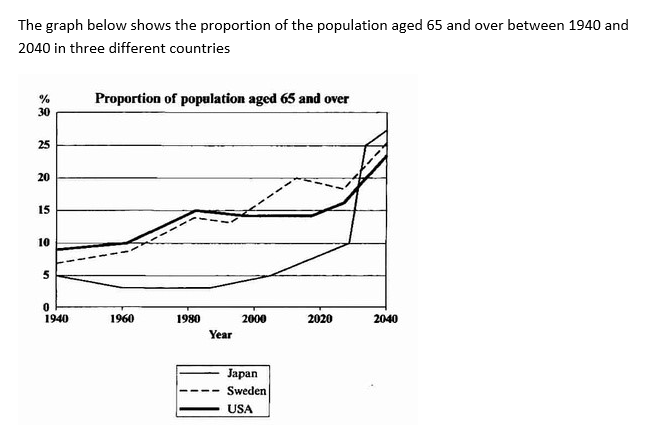

# 03 老龄人口(线图)

- 题型:线图(Task 1,三条线,1940–2040,**含未来预测**)
- 来源:`小作文/线图/老龄人口.docx`
- 首次学习:2026-11-17
- 原图:`../question/03.png`(**待补**:这次没有收到图片,项目里的 docx 也只有文字。请把图放到 `线图/question/03.png`,或者发给我,我再补「读图数据」和「核对结果」)

## 题目

The graph below shows the proportion of the population aged 65 and over between 1940 and 2040 in three different countries.



### 读图数据

**待补。** 收到原图后,我会按图读出三个国家在 1940、1990、2040 等关键年份的数值,并核对下面的范文。

## 原范文

The line graph compares the percentage of people aged 65 or more in three countries over a period of 100 years.

It is clear that the proportion of elderly people increases in each country between 1940 and 2040. Japan is expected to see the most dramatic changes in its elderly population.

In 1940, around 9% of Americans were aged 65 or over, compared to about 7% of Swedish people and 5% of Japanese people. The proportions of elderly people in the USA and Sweden rose gradually over the next 50 years, reaching just under 15% in 1990. By contrast, the figures for Japan remained below 5% until the early 2000s.

Looking into the future, a sudden increase in the percentage of elderly people is predicted for Japan, with a jump of over 15% in just 10 years from 2030 to 2040. By 2040, it is thought that around 27% of the Japanese population will be 65 years old or more, while the figures for Sweden and the USA will be slightly lower, at about 25% and 23% respectively.

### 待核对清单(等原图)

| 范文里的说法 | 待核对 |
| --- | --- |
| 1940 年:美国约 9%,瑞典约 7%,日本约 5% | 是 |
| 1990 年:美国和瑞典都略低于 15% | 是 |
| 日本到 2000 年代初都低于 5% | 是(和 1940 年的 5% 是否矛盾) |
| 日本 2030–2040 年间上升超过 15 个百分点 | 是 |
| 2040 年:日本约 27%,瑞典约 25%,美国约 23% | 是 |
| 哪一年开始是预测数据 | 是(决定哪些句子用将来式) |

### 只看文字,已经能发现的问题

| 位置 | 问题 |
| --- | --- |
| `a jump of over 15%` | 这是**百分点**的变化,不是 15% 的增长。应写 `a jump of over 15 percentage points`(和表格 03 的手机用途同一个规则) |
| 概述 `increases` | 全文其他地方用过去时和将来式,概述用一般现在时;可以统一(见下) |
| `compared to about 7% of Swedish people` | `Swedish people` 可以写成 `Swedes`,更简洁 |

## 参考修改版(Claude)

> 这一版**只改语言,数据没有动**。涉及数据的地方都标了 [核对原图],等收到图后再确认。

The line graph compares the percentage of people aged 65 or more in three countries over a period of 100 years.

It is clear that the proportion of elderly people rises in each country between 1940 and 2040. Japan is expected to see the most dramatic change, moving from the lowest proportion in 1940 to the highest in 2040. [核对原图]

In 1940, around 9% of Americans were aged 65 or over, compared with about 7% of Swedes and 5% of Japanese people. The proportions of elderly people in the USA and Sweden rose gradually over the next 50 years, reaching just under 15% in 1990. By contrast, the figures for Japan remained below 5% until the early 2000s. [核对原图]

Looking into the future, a sudden increase in the percentage of elderly people is predicted for Japan, with a jump of over 15 percentage points in just 10 years from 2030 to 2040. By 2040, it is thought that around 27% of the Japanese population will be aged 65 or over, while the figures for Sweden and the USA will be slightly lower, at about 25% and 23% respectively. [核对原图]

### 修改说明

| 位置 | 原文 | 修改 | 原因 |
| --- | --- | --- | --- |
| 概述 | Japan is expected to see the most dramatic changes in its elderly population | …the most dramatic change, moving from the lowest proportion in 1940 to the highest in 2040 | 点出日本「从最低变成最高」的反转 [核对原图] |
| 第 3 段 | compared to about 7% of Swedish people | compared with about 7% of Swedes | 更简洁 |
| 第 4 段 | a jump of over 15% | a jump of over 15 percentage points | 百分点和百分比不同 |
| 第 4 段 | 65 years old or more | aged 65 or over | 与前文统一 |

## 这篇值得学的地方

**1. 线图里既有历史,也有预测:时态要分开**
图的横轴到 2040 年,前面是已经发生的(用过去时),后面是预测(用将来式或「被预测」的说法):

| 阶段 | 时态 | 例子 |
| --- | --- | --- |
| 历史数据 | 过去时 | …were aged 65 or over;rose gradually;remained below 5% |
| 预测数据 | 将来式 / 被预测 | is predicted for Japan;is expected to see;**will** be slightly lower;it is thought that … **will** be |

写之前先问:图上从哪一年开始是预测?那一年之后的句子,都要用预测的说法。

**2. 预测的几种说法**
`is expected to + 动词`、`is predicted / projected to + 动词`、`it is thought / estimated that … will …`、`will + 动词`、`By 2040, … will be …`。

**3. 百分比和百分点**
这张图的数字本身是百分比(占总人口的比例)。比较两个数字的差,用**百分点**:`a jump of over 15 percentage points`。不能写成 `a jump of over 15%`。

**4. 三条线的轨迹对比**
- 美国、瑞典:起点较高,缓慢上升。
- 日本:起点最低,后期急剧上升,2040 年最高。

反转(从最低到最高)是这张图最有意思的特征,概述里要写出来。

**5. 按时间分段**
- 第 3 段:1940 到 2000 年代初(历史)。
- 第 4 段:2030 到 2040 年(预测)。

**6. 值得抄的句型(介词练习)**

| 句型 | 说明 |
| --- | --- |
| the percentage of people **aged** 65 or more | aged 65 or over / more |
| **over** a period **of** 100 years | over a period of |
| **In** 1940, around 9% **of** Americans …, compared **to / with** about 7% **of** Swedes | % **of** + 人群 |
| rose gradually **over** the next 50 years, reaching just under 15% **in** 1990 | over + 一段时间;reaching |
| remained below 5% **until** the early 2000s | until |
| a sudden increase … is predicted **for** Japan | predicted **for** + 国家 |
| a jump **of** over 15 percentage points **in** just 10 years **from** 2030 **to** 2040 | a jump of;in just 10 years |
| **By** 2040 … will be … **at** about 25% and 23% **respectively** | by + 年份;at + 数值 |

---

## 版本 1:我的初稿(2026-11-17,原样保留,不改动)

```text
The line graph compares the percentages of people aged 65 or over in three countries over a period of 100 years.
It is clear that , between 1940 and 2040, the proportion of each country all rose. It is expect that Japan will experience the largest change, from the lowest proportion in 1940 jump to the higest proportion in 2040.
In 1940, around 9% of Americans aged 65 or over, while that in Sweden was around 7%,and that in Japan was around 5%. Over the next 50 years, the proportion of elderly people in American and Sweden rose gradually, reaching just under 15% in 1990. By contrast, the figure for Japan keep below 5% until early 2000.
Looking at the future, it is expect that the proportion of population in Japan will suddenly rose, from 2030 to 2040, which will rose than 15% percentages in only 10 years. It is expect that around 27% of Japan aged 65 or over, while that for Sweden and American will slight lower, at around 25% and around 23% respectively.
```

> 说明:这一份的内容点和「参考修改版」几乎一一对应,句子是你自己组织的,语言错误是真实的。**数据部分我还没有原图可以核对**,所有数字和范文一致,等你发图后再确认。

### 逐句批改

**第 1 段(开头)**

没有错误。

**第 2 段(概述)**

| 问题 | 类型 | 改正 |
| --- | --- | --- |
| the proportion **of each country all rose** | **没说是什么的比例**(elderly people);each 和 all 不连用;图跨过去和未来,概述用现在时 | the proportion **of elderly people rises in each country** |
| It is **expect** that | 被动要用 expected | It is **expected** that |
| from the lowest proportion in 1940 **jump** to the **higest** proportion in 2040 | from … to … 中间不能插动词;higest 拼写 | **moving** from the lowest proportion in 1940 to the **highest** proportion in 2040 |

> 改正:It is clear that, between 1940 and 2040, the proportion of elderly people rises in each country. It is expected that Japan will experience the largest change, moving from the lowest proportion in 1940 to the highest proportion in 2040.

`will experience the largest change` 用对了将来式。

**第 3 段(1940–2000 年代初)**

| 问题 | 类型 | 改正 |
| --- | --- | --- |
| In 1940, around 9% of Americans **aged** 65 or over, while … | **没有谓语动词**:aged 65 or over 是修饰成分,不是动词 | In 1940, **the proportion of Americans aged 65 or over was** around 9%, while **that in** Sweden **was** around 7% and **that in** Japan **was** around 5% |
| the proportion of elderly people **in American** and Sweden | American 是形容词,国家名用 the USA | in **the USA** and Sweden |
| the figure for Japan **keep** below 5% | 时态;应为 remained | the figure for Japan **remained** below 5% |
| until **early 2000** | the early 2000s | until **the early 2000s** |

> 改正:In 1940, the proportion of Americans aged 65 or over was around 9%, while that in Sweden was around 7% and that in Japan was around 5%. Over the next 50 years, the proportion of elderly people in the USA and Sweden rose gradually, reaching just under 15% in 1990. By contrast, the figure for Japan remained below 5% until the early 2000s.

`that in Sweden` 的 that 用对了,只是前面一句缺少对应的 `the proportion`。`Over the next 50 years`、`reaching just under 15% in 1990`、`rose gradually`、`By contrast` 都对。

**第 4 段(预测)**

| 问题 | 类型 | 改正 |
| --- | --- | --- |
| Looking **at** the future | 介词 | Looking **into** the future |
| it is **expect** that | expected | it is **expected** that |
| the proportion of **population** in Japan | 没说是 elderly people 的比例 | the proportion of **elderly people** in Japan |
| will suddenly **rose** | will 后面用动词原形 | will suddenly **rise** |
| , from 2030 to 2040, **which will rose than** 15% **percentages** in only 10 years | 句子不通;than 不对;**百分点是 percentage points** | **with a jump of over 15 percentage points** in only 10 years **from 2030 to 2040** |
| around 27% **of Japan aged** 65 or over | **缺谓语**;Japan 是国家,应写人群 | around 27% **of the Japanese population will be aged** 65 or over |
| that for Sweden and **American** will **slight lower** | that 指两个国家,用 the figures for;American → the USA;缺 be;slight 是形容词,应为副词 slightly | **the figures for Sweden and the USA** will **be slightly lower** |
| at around 25% and around 23% | around 重复 | at around 25% and 23% |

> 改正:Looking into the future, it is expected that the proportion of elderly people in Japan will suddenly rise, with a jump of over 15 percentage points in only 10 years from 2030 to 2040. It is expected that around 27% of the Japanese population will be aged 65 or over, while the figures for Sweden and the USA will be slightly lower, at around 25% and 23% respectively.

### 最小修订(保留你的思路,只改错)

The line graph compares the percentages of people aged 65 or over in three countries over a period of 100 years.

It is clear that, between 1940 and 2040, the proportion of elderly people rises in each country. It is expected that Japan will experience the largest change, moving from the lowest proportion in 1940 to the highest proportion in 2040.

In 1940, the proportion of Americans aged 65 or over was around 9%, while that in Sweden was around 7% and that in Japan was around 5%. Over the next 50 years, the proportion of elderly people in the USA and Sweden rose gradually, reaching just under 15% in 1990. By contrast, the figure for Japan remained below 5% until the early 2000s.

Looking into the future, it is expected that the proportion of elderly people in Japan will suddenly rise, with a jump of over 15 percentage points in only 10 years from 2030 to 2040. It is expected that around 27% of the Japanese population will be aged 65 or over, while the figures for Sweden and the USA will be slightly lower, at around 25% and 23% respectively.

### 做得好的地方

- **开头句没有错误,四段结构完整。**
- **拼写错误只有 1 个(higest)。** 线图 02 是 3 处,线图 01 是 7 处。
- **预测用将来式:** `will experience`、`will be` 用上了,这是上次专门提醒的重点。
- **概述写出了日本的反转:** 从最低到最高。
- **`that in` / `that for` 用对:** 指代 proportion / figure。
- **没有缺句号**,最高级形式对(`the largest`、`the lowest`、`highest`)。
- **介词:** `Over the next 50 years`、`In 1940`、`By contrast`、`from 2030 to 2040`、`in only 10 years`、`at around 25% … respectively` 都对。
- 你尝试用 `percentages` 表示「百分点」,方向对了,只是词应为 `percentage points`。

### 本篇的介词和搭配(对照 `grammer.md`)

| 你写的 | 正确 | 规则 |
| --- | --- | --- |
| Looking **at** the future | Looking **into** the future | |
| the proportion **of each country** | the proportion **of elderly people in** each country | of + 被统计的人;in + 国家 |
| around 27% **of Japan** aged | around 27% **of the Japanese population** | % of + 人群 |
| from the lowest proportion **jump** to … | **moving** from … **to** … | from … to 中间不插动词 |
| **in American** and Sweden | in **the USA** and Sweden | 国家名(线图 02 里也出现过) |
| until **early 2000** | until **the early 2000s** | the + 年代 + s |
| 15% **percentages** | **a jump of** over 15 **percentage points** | a jump **of** |
| Over the next 50 years / In 1940 / By contrast | ✓ 对了 | |
| from 2030 **to** 2040 / **in** only 10 years | ✓ 对了 | |
| at around 25% and 23% **respectively** | ✓ 对了 | |

### 语法笔记

**1. 预测句:expected 加 will + 动词原形**

| ✗ | ✓ |
| --- | --- |
| It is **expect** that | It is **expected** that |
| will suddenly **rose** | will suddenly **rise** |
| which will **rose** | …will **rise** |
| will **slight lower** | will **be slightly lower** |

模式:`It is expected / predicted / estimated that + 主语 + will + 动词原形`,或 `主语 + is expected / predicted to + 动词原形`。will 后面永远是原形。

**2. 概述的时态**
图跨过去和未来(1940–2040),概述用一般现在时:`the proportion … rises in each country`,或者 `is expected to rise`。不用 `rose`。

**3. 每个句子要有谓语动词**
`aged 65 or over` 只是修饰成分:
- ✗ `around 9% of Americans aged 65 or over, while …`
- ✓ `the proportion of Americans aged 65 or over **was** around 9%, while …`
- ✗ `around 27% of Japan aged 65 or over`
- ✓ `around 27% of the Japanese population **will be** aged 65 or over`

**4. 说清楚比例的对象**
✗ `the proportion of each country`、`the proportion of population`
✓ `the proportion of elderly people in each country`

**5. from … to … 中间不插动词**
✗ `from the lowest proportion in 1940 jump to the highest`
✓ `moving from the lowest proportion in 1940 to the highest`

**6. 百分点:percentage points**
`a jump of over 15 percentage points`。✗ `15% percentages`。

**7. 形容词和副词**
`will be slightly lower`:slightly 是副词,修饰形容词 lower。✗ `will slight lower`(06 的 rose slow、表格 03 的 rose steable 同类)。

**8. 年代:the early 2000s**
`the early 2000s`、`the 1990s`。

**9. 国家名**
`in the USA`,不写 `in American`。线图 02 里的 `in Mexican` 同类。

### 版本 1 对比笔记

**比线图 02 的版本 1 进步的地方**
- 拼写错误从 3 处降到 1 处。
- 没有国家名和国民名大面积混用(只剩 `American` 两处)。
- 预测用将来式;概述抓到日本的反转。
- 时态只有 `keep`、`rose` 等几处。

**又出现的老问题**
- **形容词当副词:** `slight lower`。
- **American 当国家名**(线图 02)。
- **population 省掉 elderly**(线图 02、柱图 05)。
- **缺谓语的片段**(线图 02 的 `while the percentage of people just over 25% in Mexican`)。

**新出现的问题**
- **`expect` 应为 `expected`**(3 处)。
- **`will` 后面用了过去式:** `will rose`(2 处)。
- **`from … jump to …`**。
- **`Looking at the future`**。

**数据**
- 所有数字和范文一致,但**我还没有原图可以核对**。请把图片发给我,我会补上读图数据,并核对范文和你的版本里的数据。

---

## 版本 2:隔几天后重写(待写)

> 不看上面的任何内容,只看题目和原图,限时 20 分钟。

```text

```

### 写版本 2 时重点盯住的几点

1. **预测:** It is **expected** that … will + 原形;will rise,不写 will rose。
2. **每个分句有谓语:** the proportion of Americans aged 65 or over **was** around 9%。
3. **说清楚比例的对象:** the proportion of **elderly people** in Japan。
4. **百分点:** a jump of over 15 **percentage points**;from X to Y 中间不插动词。
5. **介词:** Looking **into** the future、**the USA**(不是 American)、**the early 2000s**。
6. **过去时(历史)和将来式(预测)分开;写完圈出每个动词;拼写;每段用句号收尾。**