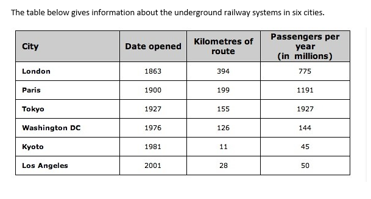

# 01 地下铁(表格)

- 题型:表格(Task 1,6 个城市 × 3 项数据:开通年份 / 线路长度 / 年乘客量)
- 来源:`小作文/表格/地下铁.docx`
- 首次学习:2026-11-11
- 原图:`../question/01.png`(已对照)

## 题目

The table below gives information about the underground railway systems in six cities.



### 读表数据

表格给的是**精确数字**,不需要估读。

| City | Date opened | Kilometres of route | Passengers per year (in millions) |
| --- | --- | --- | --- |
| London | 1863 | 394 | 775 |
| Paris | 1900 | 199 | 1191 |
| Tokyo | 1927 | 155 | 1927 |
| Washington DC | 1976 | 126 | 144 |
| Kyoto | 1981 | 11 | 45 |
| Los Angeles | 2001 | 28 | 50 |

> 注意:Tokyo 的 `1927` 出现了两次。第一个是**开通年份**,第二个是**年乘客量 1927 百万**(约 19 亿)。读表时要看清列标题。

## 原范文

The table shows data about the underground rail networks in six major cities.

The table compares the six networks in terms of their age, size and the number of people who use them each year. It is clear that the three oldest underground systems are larger and serve significantly more passengers than the newer systems.

The London underground is the oldest system, having opened in 1863. It is also the largest system, with 394 kilometres of route. The second largest system, in Paris, is only about half the size of the London underground, with 199 kilometres of route. However, it serves more people per year. While only third in terms of size, the Tokyo system is easily the most used, with 1927 million passengers per year.

Of the three newer networks, the Washington DC underground is the most extensive, with 126 kilometres of route, compared to only 11 kilometres and 28 kilometres for the Kyoto and Los Angeles systems. The Los Angeles network is the newest, having opened in 2001, while the Kyoto network is the smallest and serves only 45 million passengers per year.

### 对照原表后的核对结果

| 范文里的说法 | 与表是否一致 |
| --- | --- |
| 最老的三个系统(伦敦、巴黎、东京)规模更大、乘客更多 | 一致(394 / 199 / 155 km 对 126 / 11 / 28 km;775 / 1191 / 1927 对 144 / 45 / 50 百万) |
| 伦敦最老(1863),也最长(394 km) | 一致 |
| 巴黎约为伦敦的一半(199 对 394) | 一致(199 ÷ 394 ≈ 0.5) |
| 巴黎乘客比伦敦多 | 一致(1191 对 775) |
| 东京规模第三,乘客最多(1927 百万) | 一致 |
| 华盛顿是三个较新系统中最长的(126 km),京都 11 km、洛杉矶 28 km | 一致,顺序也对(京都 11、洛杉矶 28) |
| 洛杉矶最新(2001),京都最短、乘客 45 百万 | 一致 |

数据全部正确。只是**不完整**:华盛顿的乘客数(144)、洛杉矶的乘客数(50)、东京的线路长度(155)都没有写。

## 参考修改版(Claude)

The table compares the underground railway systems in six cities in terms of their age, size and annual passenger numbers.

It is clear that the three oldest underground systems, in London, Paris and Tokyo, are larger and serve significantly more passengers than the three newer systems.

The London underground is the oldest system, having opened in 1863. It is also the largest, with 394 kilometres of route. The second largest system, in Paris, is only about half the size of the London underground, with 199 kilometres of route, but it serves more passengers per year (1,191 million compared with 775 million). Although it is only third in terms of size, at 155 kilometres, the Tokyo system is easily the most used, with 1,927 million passengers per year.

Of the three newer networks, the Washington DC underground is the most extensive, with 126 kilometres of route and 144 million passengers per year. By comparison, the Kyoto and Los Angeles systems are much smaller, with only 11 and 28 kilometres of route and just 45 and 50 million passengers a year respectively. The Los Angeles network is the newest, having opened in 2001, while the Kyoto network is the smallest and the least used.

### 修改说明

| 位置 | 原文 | 修改 | 原因 |
| --- | --- | --- | --- |
| 开头 | 第 1 段 `The table shows data about …`,第 2 段第一句 `The table compares …` | 合并成一句开头 | 两句意思重复;概述段应该从 `It is clear that` 开始 |
| 开头 | six major cities | six cities | major 不是表里的信息 |
| 数字格式 | 1927 million | 1,927 million | 加千位逗号 |
| 补充 | Tokyo 只写了 `third in terms of size` | 加 `at 155 kilometres` | 补上数字,和其他城市一致 |
| 补充 | 华盛顿的乘客数、洛杉矶的乘客数没有写 | 补上 144 和 50 | 表格题要把每个城市的关键数据覆盖到 |
| 表达 | the number of people who use them each year | annual passenger numbers | 更简洁 |

这篇范文质量很高,结构清楚,数据全对,上面的修改都是小改动。

## 这篇值得学的地方

**1. 表格题 = 找分组依据 + 比较**
表格有 6 行 × 3 列 = 18 个数字,不要逐个城市报数。关键是找出分组的依据:这里按**开通年份**分成两组:
- 最老的三个(伦敦 1863、巴黎 1900、东京 1927):规模更大、乘客更多。
- 较新的三个(华盛顿 1976、京都 1981、洛杉矶 2001):规模更小、乘客更少。

概述把这个规律写出来,第 3 段写前一组,第 4 段写后一组。

**2. 表格给的是精确数字,直接写**
和柱图、线图不同,表格的数字是精确的,所以**不用 about / around / approximately**,直接写 `394 kilometres`、`1,191 million`。

**3. 时态**
- 现状用一般现在时:`is the oldest`、`serves`、`is the most extensive`。
- 开通年份是过去的事件:`opened in 1863`,或者 `having opened in 1863`。

**4. 注意大数和单位**
`Passengers per year (in millions)`:1191 就是 `1,191 million`,1927 就是 `1,927 million`(约 19 亿,也可以写 nearly 2 billion)。千位加逗号,单位不要漏。

**5. 值得抄的句型(也是介词的好例子)**

| 句型 | 说明 |
| --- | --- |
| The London underground is the oldest system, **having opened in** 1863 | having opened:完成分词,补充原因或背景 |
| It is also the largest, **with 394 kilometres of route** | with 补充细节(with 表示具有) |
| The second largest system, in Paris, is only about **half the size of** the London underground | half the size **of**:倍数 + of |
| **While** only third **in terms of** size, the Tokyo system is easily the most used | while + 省略主语和 be;in terms of |
| …, compared to only 11 kilometres and 28 kilometres **for** the Kyoto and Los Angeles systems | for + 数据属于谁(the figures **for** …) |
| …, **having opened in** 2001, **while** the Kyoto network is the smallest | while 对比 |
| serves … passengers **per year** | per year |

**6. 描述排名和极值**
`the oldest / the largest / the second largest / third in terms of size / the most extensive / the newest / the smallest / the most used / the least used`。

**7. 表格和柱图的区别**

| | 柱图 / 线图 | 表格 |
| --- | --- | --- |
| 数字 | 从图上估读,有误差 | 精确,直接写 |
| 近似词 | about / around / just over | 一般不需要 |
| 分组 | 按趋势、交叉点 | 按某一列的特征(这里是开通年份) |
| 重点 | 变化、对比 | 对比、排名、极值 |

---

## 版本 1:我的初稿(2026-11-11,原样保留,不改动)

```text
The table below compares the underground railway systems in six cities in terms of their age, size and annual passenger numbers.

It is clear that the three underground railway system ,in London, Paris and Tokyo , were the most old, with significantly larger  size and more passengers more than those of the three newer underground railway systems

London underground railway is the oldest system, having opened in 1863. It is also the largest one, with 394 kilometers. The second largest system located in Paris , with only half  size of that of London, which has 199 kilomenters, while the annual passenger number was more than that of London(1,191 million compared with 775 million).Although Kyoto was in the thrid palce in size,with 155 kilomnters, but with most used, which annual passenger number is 1,927 million

In the newer networks, the underground railway of Washington DC is the largest, with 126 kilometres, and the annual passenger number is 144 million. By constrast, that of Kyoto and Los Angeles is way samll, with only 11 kilomenters and 28 kilomenters respectively and the annual passenger number of 45 million and 50 million respectively. The network of Los Angeles is the most new, having opened in 2001, while the network in Kyoto is the most small and lowest used.
```

> 说明:开头句和我的修改版几乎一致,其余句子是你自己组织的。整体结构和修改版对应,所以内容覆盖得很全,但语言错误是真实的。

### 逐句批改

**第 1 段(开头)**

没有错误。

**第 2 段(概述)**

| 问题 | 类型 | 改正 |
| --- | --- | --- |
| the three underground railway system | 单复数 | systems |
| were the most old | **最高级错误**:old 的最高级是 oldest;时态:表格描述现状,用现在时 | are the oldest |
| with significantly larger size and more passengers more than those of … | `more … more than` 重复;larger size 不自然 | are significantly larger and serve more passengers than the three newer … systems |
| 句末缺句号 | 标点 | 加句号 |

> 改正:It is clear that the three oldest underground railway systems, in London, Paris and Tokyo, are significantly larger and serve more passengers than the three newer underground railway systems.

**第 3 段(伦敦、巴黎、东京)**

| 问题 | 类型 | 改正 |
| --- | --- | --- |
| London underground railway is | 缺冠词 | The London underground railway is |
| 394 kilometers | 拼写不统一:表里是英式 kilometres;缺 of route | 394 kilometres of route |
| The second largest system located in Paris, with only half size of that of London, … | **没有谓语动词,不是完整的句子**;half size 缺 the;`half the size of that of London` 重复 of | The second largest system, in Paris, is about half the size of the London system, with 199 kilometres of route |
| which has 199 kilomenters | **指代不清**:which 会被理解成 London(London 是 394);kilomenters 拼写 | with 199 kilometres of route |
| the annual passenger number was more than that of London | 时态(was → is);数量对数量,that of 用对了 | its annual passenger number is higher than that of London |
| Although **Kyoto** was in the thrid palce in size, with 155 kilomnters | **内容错误:155 公里是东京(Tokyo),不是京都**;thrid palce 拼写;in the third place 应为 in third place;kilomnters 拼写 | Although **Tokyo** is only third in terms of size, with 155 kilometres of route |
| …, but with most used, which annual passenger number is 1,927 million | **Although … but 不能连用**;缺主语;with most used 不通;which annual passenger number is 不通;句末缺句号 | it is the most used, with an annual passenger number of 1,927 million. |

> 改正:The London underground railway is the oldest system, having opened in 1863. It is also the largest one, with 394 kilometres of route. The second largest system, in Paris, is about half the size of the London system, with 199 kilometres of route, while its annual passenger number is higher than that of London (1,191 million compared with 775 million). Although Tokyo is only third in terms of size, with 155 kilometres of route, it is the most used, with an annual passenger number of 1,927 million.

**第 4 段(较新的三个系统)**

| 问题 | 类型 | 改正 |
| --- | --- | --- |
| In the newer networks, … is the largest | 介词:在一组里选最高,用 Of / Among,不用 In | **Of** the three newer networks, … |
| with 126 kilometres, and the annual passenger number is 144 million | 并列不平行(短语 + 从句) | with 126 kilometres of route and an annual passenger number of 144 million |
| By constrast | 拼写(08 里也写成了 constrast) | By contrast |
| that of Kyoto and Los Angeles **is** | that 指两个系统,应为复数:those … are | the Kyoto and Los Angeles systems are |
| way samll | way 太口语;samll 拼写;应为 much smaller | much smaller |
| 11 kilomenters and 28 kilomenters respectively and … 45 million and 50 million respectively | 拼写;respectively 用对了,但一句里用了两次,可以合并成一次 | with only 11 and 28 kilometres of route and annual passenger numbers of 45 and 50 million respectively |
| the most new | **最高级错误** | the newest |
| the most small and lowest used | **最高级错误**;used 的最高级 / 最低级是 the most / least used | the smallest and the least used |

> 改正:Of the three newer networks, the underground railway of Washington DC is the largest, with 126 kilometres of route and an annual passenger number of 144 million. By contrast, the Kyoto and Los Angeles systems are much smaller, with only 11 and 28 kilometres of route and annual passenger numbers of 45 and 50 million respectively. The network of Los Angeles is the newest, having opened in 2001, while the network in Kyoto is the smallest and the least used.

### 最小修订(保留你的思路,只改错)

The table below compares the underground railway systems in six cities in terms of their age, size and annual passenger numbers.

It is clear that the three oldest underground railway systems, in London, Paris and Tokyo, are significantly larger and serve more passengers than the three newer underground railway systems.

The London underground railway is the oldest system, having opened in 1863. It is also the largest one, with 394 kilometres of route. The second largest system, in Paris, is about half the size of the London system, with 199 kilometres of route, while its annual passenger number is higher than that of London (1,191 million compared with 775 million). Although Tokyo is only third in terms of size, with 155 kilometres of route, it is the most used, with an annual passenger number of 1,927 million.

Of the three newer networks, the underground railway of Washington DC is the largest, with 126 kilometres of route and an annual passenger number of 144 million. By contrast, the Kyoto and Los Angeles systems are much smaller, with only 11 and 28 kilometres of route and annual passenger numbers of 45 and 50 million respectively. The network of Los Angeles is the newest, having opened in 2001, while the network in Kyoto is the smallest and the least used.

### 做得好的地方

- **概述抓到了规律:** 最老的三个系统更大、乘客更多。
- **数据覆盖很全:** 六个城市、三列数据都写到了,包括华盛顿和洛杉矶的乘客数。
- **数字格式对了:** `1,191 million`、`1,927 million` 都加了千位逗号。
- **`respectively` 用对了**,两处对应关系都正确,拼写也对了(08 里你写的是 resptively)。
- **比较句:** `the annual passenger number was more than that of London`,数量比数量,用了 that of,比较对象一致。
- 用了 `having opened in`、`compared with`、`in terms of` 等固定搭配。

### 本篇的介词和搭配(对照 `grammer.md`)

| 你写的 | 正确 | 规则 |
| --- | --- | --- |
| **In** the newer networks, … the largest | **Of** the three newer networks, … | 在一组里选最高 / 最低,用 of / among |
| half size **of** that of London | half **the** size of the London system | half the size **of** + 名词,不再加 that of |
| which annual passenger number **is** | **with** an annual passenger number **of** 1,927 million | with + 名词 + of + 数量 |
| 394 kilometers | 394 kilometres **of route** | 表里的列标题是 Kilometres of route |
| in the third place in size | third **in terms of** size | in terms of 带出比较的维度 |
| Although … , **but** … | Although …, … (或 … , but …) | although 和 but 二选一 |
| compared **with** | ✓ 对了 | |
| in terms of | ✓ 对了 | |
| opened **in** 1863 | ✓ 对了 | |

### 语法笔记

**1. 最高级:短形容词加 -est,不要写 most + 形容词**
这是你第五次出现同一类错误:01 的 `more lower`,05 的 `more younger`,07 的 `the most lower`,这次的 `the most old`、`the most new`、`the most small`。

| 形容词 | 比较级 | 最高级 |
| --- | --- | --- |
| old | older | the **oldest** |
| new | newer | the **newest** |
| small | smaller | the **smallest** |
| large | larger | the **largest** |
| low | lower | the **lowest** |
| high | higher | the **highest** |
| long | longer | the **longest** |

长的形容词和分词才用 most:`the most extensive`、`the most used`。「最少」用 `the least used`,不写 `the lowest used`。**规则:单音节的短形容词(old、new、small、low、high)直接加 -er / -est,不加 more / most。**

**2. 表格是现状,用现在时,全文统一**
你写了 `were the most old`、`was more than that of London`,和后面的 `is the largest` 混在一起。表格没有年份、描述的是现在的系统,所以统一用现在时(are、is、serves)。开通年份才用过去时(opened in 1863)。

**3. 一个句子必须有主语和谓语**
`The second largest system located in Paris, with only half size …` 这句里,`located in Paris` 是修饰成分,整句没有谓语。改成 `The second largest system, in Paris, is about half the size of …`。

**4. Although 和 but 二选一**
✗ `Although Tokyo is third in size, but it is the most used.`
✓ `Although Tokyo is third in size, it is the most used.`
✓ `Tokyo is third in size, but it is the most used.`

**5. which 指代最近的名词**
`…of that of London, which has 199 kilomenters`:读者会以为 which 指 London。改用 `with 199 kilometres of route` 补充说明,更清楚。

**6. 并列结构要平行**
✗ `with 126 kilometres, and the annual passenger number is 144 million`(短语 + 从句)
✓ `with 126 kilometres of route and an annual passenger number of 144 million`(两个名词短语)

**7. half 的写法**
`half the size of the London system`、`about half the size of …`。不写 `half size of that of`。

**8. Tokyo 和 Kyoto 别混**
你把 Tokyo 的数据(155 公里、1,927 百万)写成了 Kyoto。读表时看清每一行:Tokyo(1927、155、1927)、Kyoto(1981、11、45)。写完逐个数据回表核对。

### 版本 1 对比笔记

**比柱图的版本 1 进步的地方**
- 千位逗号全部加了。
- `respectively` 用法正确,拼写也对。
- 数据覆盖完整,概述抓到了规律。
- 没有再出现 `sale` / `sales`、`reach to` 这类词形错误。

**又出现的老问题**
- **最高级:** `the most old / the most new / the most small`,第五次。
- **constrast:** 08 里也是这样拼,同样的错拼重复了。
- **时态混用**(were / was / is)、**缺句号**、**that of 指代复数**。
- **kilometres 拼写:** kilomenters(3 处)、kilomnters、kilometers,一共 5 种写法。表里是英式拼写 kilometres,我把它加进了易错词表。

**新出现的问题**
- **内容错误:** Tokyo 写成了 Kyoto。
- **句子不完整:** 两个句子缺谓语 / 缺主句。
- **`Although … but`** 连用。
- **`In the newer networks`**:应为 `Of the three newer networks`。

---

## 版本 2:隔几天后重写(待写)

> 不看上面的任何内容,只看题目和原表,限时 20 分钟。

```text

```

### 写版本 2 时重点盯住的几点

1. **最高级:** the oldest、the newest、the smallest、the largest(不写 most + 短形容词);the most used / the least used。
2. **全文现在时**(开通年份用过去时)。
3. **每个句子都有主语和谓语;Although 和 but 二选一;并列结构平行。**
4. **读表核对:** Tokyo 和 Kyoto 别混,写完逐个数据回表核对。
5. **拼写:** kilometres、contrast、third、place、small。
6. **每段用句号收尾。**