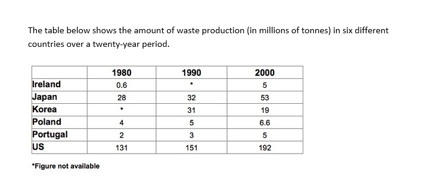

# 02 垃圾制造(表格)

- 题型:表格(Task 1,6 个国家 × 3 个年份,带缺失数据)
- 来源:`小作文/表格/垃圾制造.docx`
- 首次学习:2026-11-12
- 原图:`../question/02.png`(已对照)

## 题目

The table below shows the amount of waste production (in millions of tonnes) in six different countries over a twenty-year period.



### 读表数据

单位:百万吨。`*` 表示数据缺失(Figure not available)。

| Country | 1980 | 1990 | 2000 |
| --- | --- | --- | --- |
| Ireland | 0.6 | * | 5 |
| Japan | 28 | 32 | 53 |
| Korea | * | 31 | 19 |
| Poland | 4 | 5 | 6.6 |
| Portugal | 2 | 3 | 5 |
| US | 131 | 151 | 192 |

> 两个缺失值:**爱尔兰 1990 年**、**韩国 1980 年**。写作时,不能对缺失的年份下结论。

## 原范文

The chart compares the amounts of waste that were produced in six countries in the years 1980, 1990 and 2000.

In each of these years, the US produced more waste than Ireland, Japan, Korea, Poland and Portugal combined. It is also noticeable that Korea was the only country that managed to reduce its waste output by the year 2000.

Between 1980 and 2000, waste production in the US rose from 131 to 192 million tonnes, and rising trends were also seen in Japan, Poland and Portugal. Japan's waste output increased from 28 to 53 million tonnes, while Poland and Portugal saw waste totals increase from 4 to 6.6 and from 2 to 5 million tonnes respectively.

The trends for Ireland and Korea were noticeably different from those described above. In Ireland, waste production increased more than eightfold, from only 0.6 million tonnes in 1980 to 5 million tonnes in 2000. Korea, by contrast, cut its waste output by 12 million tonnes between 1990 and 2000.

### 对照原表后的核对结果

| 范文里的说法 | 与表是否一致 |
| --- | --- |
| 每一年美国的垃圾量都超过其余五国之和 | 一致(1980:131 对 34.6;1990:151 对 71;2000:192 对 88.6),但爱尔兰 1990、韩国 1980 缺数据,实际是「有数据的国家之和」 |
| 韩国是唯一减少的国家 | 一致(31 → 19) |
| 美国 131 → 192 | 一致 |
| 日本 28 → 53 | 一致(几乎翻倍,53 ÷ 28 ≈ 1.9) |
| 波兰 4 → 6.6,葡萄牙 2 → 5,respectively | 一致,顺序也对 |
| 爱尔兰增长超过八倍(0.6 → 5) | 一致(5 ÷ 0.6 ≈ 8.3) |
| 韩国比 1990 年减少 12 百万吨 | 一致(31 − 19 = 12) |
| `The trends for Ireland and Korea were noticeably different` | **不够准确**:爱尔兰的方向也是上升,只是幅度最大;它和韩国放在一起,更像是因为两国各缺一个年份的数据 |

数据全部正确。主要问题是:没有提到缺失数据,爱尔兰的分组理由不准确,概述缺少整体趋势。

## 参考修改版(Claude)

The table compares the amount of waste produced in six countries in 1980, 1990 and 2000, measured in millions of tonnes.

In each year, the US produced more waste than the other five countries combined. It is also noticeable that waste output rose in every country except Korea, which was the only country to reduce its total between 1990 and 2000.

Between 1980 and 2000, waste production in the US rose from 131 to 192 million tonnes, and rising trends were also seen in Japan, Poland and Portugal. Japan's waste output almost doubled, from 28 to 53 million tonnes, while Poland and Portugal saw their totals increase from 4 to 6.6 and from 2 to 5 million tonnes respectively.

Ireland also saw a rise, from only 0.6 million tonnes in 1980 to 5 million tonnes in 2000, an increase of more than eightfold, although no figure is available for 1990. Korea, by contrast, cut its waste output by 12 million tonnes, from 31 to 19 million tonnes, between 1990 and 2000 (no figure is available for 1980).

### 修改说明

| 位置 | 原文 | 修改 | 原因 |
| --- | --- | --- | --- |
| 开头句 | The chart compares the amounts of waste that were produced in six countries in the years 1980, 1990 and 2000. | The table compares the amount of waste produced in six countries in 1980, 1990 and 2000, measured in millions of tonnes. | 这是表格,不是 chart;waste 不可数,用 the amount of;去掉 that were 和 the years;补上单位 |
| 概述 | 只写了美国最多、韩国唯一减少 | 加 waste output rose in every country except Korea | 概述要给出整体趋势 |
| 缺失数据 | 没有提到 | 写出 no figure is available | 表里有 `*`,要么说明,要么不对缺失的年份下结论 |
| 分组 | The trends for Ireland and Korea were noticeably different from those described above | Ireland also saw a rise …;Korea, by contrast, … | 爱尔兰的方向也是上升,只是幅度最大 |
| 补充 | Japan's waste output increased from 28 to 53 | almost doubled, from 28 to 53 | 53 ÷ 28 ≈ 1.9,补上倍数 |
| 概述 | the US produced more waste than … combined | the other five countries combined | 更简洁,更顺 |

## 这篇值得学的地方

**1. 带缺失数据的表格怎么写**
表里有两个 `*`:爱尔兰 1990 年、韩国 1980 年。
- 不要对缺失的年份下结论。韩国只能写 1990–2000 年(减少了),爱尔兰只能写 1980 到 2000 年(增长了 8 倍多)。
- 可以用一句话说明:`no figure is available for 1990`。
- 比较「美国超过其余五国之和」时,严格来说是「有数据的国家之和」。

**2. 数量级差别大,怎么写**
美国 131–192 百万吨,爱尔兰只有 0.6–5。不要平均用力,而是:
- 先抓最突出的:美国比其余五国加起来还多(`more than … combined`)。
- 再按趋势分组:增长的(美国、日本、波兰、葡萄牙)、增幅最大的(爱尔兰)、唯一下降的(韩国)。

**3. 倍数和幅度**

| 实际变化 | 写法 |
| --- | --- |
| 0.6 → 5(约 8.3 倍) | increased **more than eightfold** |
| 28 → 53(约 1.9 倍) | **almost doubled** |
| 31 → 19(减少 12) | cut … **by 12 million tonnes** |
| 131 → 192(增加 61,约 47%) | rose **by about 47%** / rose from 131 to 192 |

倍数词:`twofold / doubled`、`threefold / tripled`、`fourfold`……`eightfold`。幅度用 by:`by 12 million tonnes`。

**4. 同义表达,避免重复**
同一个意思换着说:
- 垃圾量:`waste production`、`waste output`、`waste totals`、`the amount of waste produced`。
- 增加:`rose`、`increased`、`grew`、`saw … increase`。
- 减少:`cut`、`reduced`、`fell`、`decreased`。

**5. 时态**
有具体年份(1980、1990、2000),用过去时(produced、rose、increased、cut)。对比上一篇地下铁:没有年份的现状用现在时。

**6. 值得抄的句型**

| 句型 | 用法 |
| --- | --- |
| In each of these years, the US produced more waste than A, B, C, D and E combined | combined 表示加起来 |
| Korea was the only country that managed to reduce its waste output | the only country that managed to |
| waste production in the US rose from 131 to 192 million tonnes | from … to … |
| rising trends were also seen in Japan, Poland and Portugal | 被动 + also |
| Poland and Portugal saw waste totals increase from 4 to 6.6 and from 2 to 5 million tonnes respectively | saw + 宾语 + 动词原形;respectively 对应两个国家 |
| increased more than eightfold, from only 0.6 million tonnes in 1980 to 5 million tonnes in 2000 | 倍数 + from only … to … |
| cut its waste output by 12 million tonnes between 1990 and 2000 | by 幅度;between … and … |

介词提示:`from … to …`(起点到终点)、`by`(幅度)、`between … and …`(时间范围)、`in 1980`(年份)、`for`(数据属于谁)。

**7. 和上一篇表格对比**

| | 表格 01 地下铁 | 表格 02 垃圾制造 |
| --- | --- | --- |
| 数据 | 当前的现状,3 列数据 | 3 个年份的变化,带缺失数据 |
| 时态 | 现在时(开通年份用过去时) | 过去时 |
| 分组 | 按开通年份分新旧两组 | 按趋势分组:美国 / 增长 / 爱尔兰 / 韩国 |
| 重点 | 排名、极值 | 趋势、倍数、缺失数据 |

---

## 版本 1:我的初稿(待写)

> 建议先不要看上面的修改版,只看题目和原表,限时 20 分钟写一版。写之前先在草稿纸上做三件事:① 圈出缺失数据;② 算出每个国家的变化(增加还是减少、多少、几倍);③ 按趋势把国家分组。写完后原样贴在下面,不要事后改动,先对照 `error-log.md` 的「高频五条」过一遍,再发给我批改。

```text

```

### 写作时重点盯住的几点

1. **缺失数据:** 不对缺失的年份下结论,必要时写 `no figure is available`。
2. **过去时:** 1980、1990、2000 是具体年份。
3. **分组和倍数:** 先抓美国,再按趋势分组;倍数先算再写(eightfold、almost doubled)。
4. **单位:** million tonnes,精确数字直接写,不加 about。
5. **介词:** from … to …、by 12 million tonnes、between … and …、in 1980。
6. **高频五条:** 最高级(短形容词 -est)、that of / those of、每段用句号收尾、拼写(Ireland、Poland、Portugal、Japan、Korea、tonnes)。