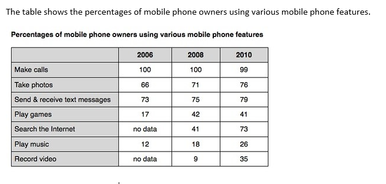

# 03 手机用途(表格)

- 题型:表格(Task 1,百分比;7 项功能 × 3 个年份,带缺失数据)
- 来源:`小作文/表格/手机用途.docx`
- 首次学习:2026-11-12
- 原图:`../question/03.png`(已对照)

## 题目

The table shows the percentages of mobile phone owners using various mobile phone features.



### 读表数据

数字是**百分比**(使用该功能的手机用户占全部手机用户的比例)。

| Feature | 2006 | 2008 | 2010 |
| --- | --- | --- | --- |
| Make calls | 100 | 100 | 99 |
| Take photos | 66 | 71 | 76 |
| Send & receive text messages | 73 | 75 | 79 |
| Play games | 17 | 42 | 41 |
| Search the Internet | no data | 41 | 73 |
| Play music | 12 | 18 | 26 |
| Record video | no data | 9 | 35 |

> 两个缺失值:**2006 年的 Search the Internet 和 Record video**。年份是 2006、2008、2010,不是连续的每一年。

## 原范文

The table compares the percentages of people using different functions of their mobile phones between 2006 and 2010.

Throughout the period shown, the main reason why people used their mobile phones was to make calls. However, there was a marked increase in the popularity of other mobile phone features, particularly the Internet search feature.

In 2006, 100% of mobile phone owners used their phones to make calls, while the next most popular functions were text messaging (73%) and taking photos (66%). By contrast, less than 20% of owners played games or music on their phones, and there were no figures for users doing Internet searches or recording video.

Over the following 4 years, there was relatively little change in the figures for the top three mobile phone features. However, the percentage of people using their phones to access the Internet jumped to 41% in 2008 and then to 73% in 2010. There was also a significant rise in the use of mobiles to play games and to record video, with figures reaching 41% and 35% respectively in 2010.

### 对照原表后的核对结果

| 范文里的说法 | 与表是否一致 |
| --- | --- |
| 整个时期,打电话是最主要的用途 | 一致(100 → 100 → 99) |
| 其他功能明显增长,尤其是上网 | 一致(上网 41 → 73) |
| 2006 年短信 73%、拍照 66% | 一致 |
| 2006 年玩游戏、听音乐不到 20% | 一致(17、12) |
| 2006 年上网和录像没有数据 | 一致 |
| 前三名功能 `relatively little change` | **不够准确**:打电话几乎不变(100 → 99),短信 +6,但拍照 66 → 76,上升了 10 个百分点,而且是每次都在升 |
| 上网 2008 年 41%,2010 年 73% | 一致 |
| 玩游戏、录像在 2010 年分别达到 41% 和 35% | 数字一致,但**游戏的增长发生在 2006–2008 年(17 → 42),2010 年反而略降(41)**;`rise … reaching 41%` 容易让人以为一直在涨 |
| 听音乐(12 → 18 → 26)、2010 年短信 79%、拍照 76% | **没有写** |

数据全部正确,只是有两处概括不够准确,并且漏了几个数据。

## 参考修改版(Claude)

The table compares the percentages of mobile phone owners who used seven different phone features in 2006, 2008 and 2010.

It is clear that making calls was the most common use of mobile phones throughout the period, with almost all owners using this feature. All of the other features became more popular, especially searching the Internet and recording video.

In 2006, 100% of mobile phone owners used their phones to make calls, while the next most popular features were text messaging (73%) and taking photos (66%). By contrast, less than 20% of owners played games or music on their phones, and there were no figures for Internet searches or video recording. The figure for calls remained at 100% in 2008 and fell only slightly to 99% in 2010.

Over the following four years, the figures for text messaging and photo-taking rose steadily, to 79% and 76% respectively in 2010. The biggest changes were seen in other features. The percentage of owners searching the Internet rose from 41% in 2008 to 73% in 2010, while the figure for video recording almost quadrupled, from 9% to 35%. Game playing more than doubled between 2006 and 2008, from 17% to 42%, but then stayed at the same level (41%) in 2010. Music playing grew more slowly, from 12% to 26% over the period.

### 修改说明

| 位置 | 原文 | 修改 | 原因 |
| --- | --- | --- | --- |
| 开头句 | the percentages of people using different functions of their mobile phones between 2006 and 2010 | the percentages of mobile phone owners who used seven different phone features in 2006, 2008 and 2010 | 表里是 mobile phone owners;数据只有 2006、2008、2010 三个年份;说明有七项功能 |
| 概述 | the main reason why people used their mobile phones was to make calls … marked increase in the popularity of other features | making calls was the most common use …;All of the other features became more popular, especially … | 点明「其余所有功能都在增长」,并且把上网和录像一起列为增长最明显的 |
| 前三名功能 | relatively little change in the figures for the top three | texting and photo-taking rose steadily, to 79% and 76% respectively | 拍照上升了 10 个百分点,不能说「变化很小」;补上 2010 年的数据 |
| 游戏 | a significant rise … reaching 41% … in 2010 | more than doubled between 2006 and 2008, but then stayed at the same level (41%) | 游戏的增长发生在 2006–2008 年,2010 年略降 |
| 遗漏 | 听音乐没有写 | Music playing grew more slowly, from 12% to 26% | 覆盖全部七项功能 |
| 打电话 | 只写了 2006 年 100% | remained at 100% in 2008 and fell only slightly to 99% in 2010 | 补全 2008 和 2010 年的数据 |

## 这篇值得学的地方

**1. 百分比和百分点**
表里的数字本身是百分比。描述变化时,有两种说法,不要混:
- 写起点和终点最安全:`rose from 66% to 76%`。
- 写幅度用百分点:`rose by 10 percentage points`。

不要写 `rose by 10%`:66% 的 10% 是 6.6,而 66 → 76 的相对增长是约 15%,容易误解。

**2. 按变化模式分组**
七项功能 × 三个年份,不要逐项报数。按变化的模式分成三类:
- **几乎不变:** 打电话(100 → 100 → 99)。
- **稳步上升:** 短信(73 → 75 → 79)、拍照(66 → 71 → 76)、听音乐(12 → 18 → 26)。
- **大幅增长:** 上网(41 → 73)、录像(9 → 35)、游戏(17 → 42 后持平)。

**3. 带缺失数据的表格(又一次)**
2006 年上网和录像都是 `no data`。和上一篇垃圾制造一样:不对缺失的年份下结论,写 `there were no figures for …`;上网和录像只能写 2008–2010 年的变化。

**4. 时态**
2006、2008、2010 是具体年份,用过去时(was、rose、jumped、remained)。

**5. 倍数和变化词**

| 实际变化 | 写法 |
| --- | --- |
| 9 → 35(约 3.9 倍) | almost quadrupled / nearly fourfold |
| 17 → 42(约 2.5 倍) | more than doubled |
| 42 → 41 | stayed at the same level / remained almost unchanged |
| 41 → 73 | jumped to 73% / rose sharply |
| 100 → 99 | fell only slightly |
| 66 → 71 → 76 | rose steadily |

**6. 同一个功能的不同说法**

| 表里的写法 | 范文里的换法 |
| --- | --- |
| Make calls | making calls / to make calls |
| Take photos | taking photos |
| Send & receive text messages | text messaging |
| Search the Internet | Internet searches / to access the Internet |
| Play games / Play music | to play games / game playing / music playing |
| Record video | recording video / video recording |

**7. 值得抄的句型**

| 句型 | 说明 |
| --- | --- |
| the main reason why people used their mobile phones was to make calls | 句型:the main reason … was to + 动词 |
| there was a marked increase in the popularity of …, particularly … | an increase in … ;particularly 强调最突出的 |
| 100% of mobile phone owners used …, while the next most popular functions were … | while 对比;the next most popular |
| less than 20% of owners played games or music on their phones | less than |
| there were no figures for users doing Internet searches or recording video | no figures for … |
| jumped to 41% in 2008 and then to 73% in 2010 | jumped to … and then to … |
| with figures reaching 41% and 35% respectively in 2010 | with + 现在分词;respectively |

**8. 最高级的练习机会**
`the most common use`、`the most popular`、`the next most popular` 里的 popular、common 是较长的形容词,用 most;而 `the oldest / the newest / the smallest` 这类短形容词用 -est。

**9. 三篇表格对比**

| 篇目 | 数据 | 时态 | 重点 |
| --- | --- | --- | --- |
| 表 01 地下铁 | 当前现状,3 列 | 现在时 | 分组(新旧)、排名 |
| 表 02 垃圾制造 | 3 个年份,吨数,有缺失 | 过去时 | 趋势、倍数、缺失数据 |
| 表 03 手机用途 | 3 个年份,百分比,有缺失 | 过去时 | 按变化模式分组、百分点 |

---

## 版本 1:我的初稿(待写)

> 建议先不要看上面的修改版,只看题目和原表,限时 20 分钟写一版。写之前先在草稿纸上做三件事:① 圈出缺失数据;② 算出每项功能的变化(升还是降、多少、几倍);③ 按变化模式把 7 项功能分组。写完后原样贴在下面,不要事后改动,先对照 `error-log.md` 的「高频五条」过一遍,再发给我批改。

```text

```

### 写作时重点盯住的几点

1. **缺失数据:** 2006 年的上网和录像没有数据,不要对 2006 年下结论。
2. **分组:** 打电话(不变)/ 稳步上升 / 大幅增长。
3. **百分点:** 写 `from 66% to 76%` 或 `by 10 percentage points`,不写 `by 10%`。
4. **过去时;最高级:** the most popular(长形容词用 most)、the next most popular。
5. **主语:** 变化的是 the percentage of owners / the figure,不是 phones;the figure **for** video recording(for 接数据属于谁)。
6. **高频五条:** that of / those of、每段用句号收尾、拼写(percentage、features、Internet、respectively)。