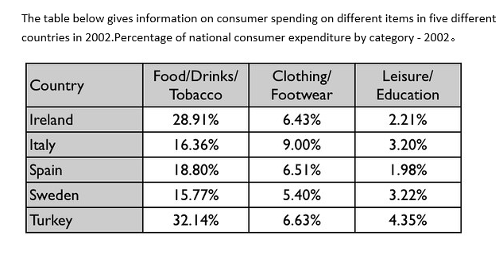

# 04 消费开支(表格)

- 题型:表格(Task 1,占比;5 个国家 × 3 个消费类别,单一年份 2002)
- 来源:`小作文/表格/消费开支.docx`
- 首次学习:2026-11-13
- 原图:`../question/04.png`(已对照)

## 题目

The table below gives information on consumer spending on different items in five different countries in 2002. Percentage of national consumer expenditure by category - 2002.



### 读表数据

数字是**占全国消费总支出的百分比**,不是金额。

| Country | Food/Drinks/Tobacco | Clothing/Footwear | Leisure/Education |
| --- | --- | --- | --- |
| Ireland | 28.91% | 6.43% | 2.21% |
| Italy | 16.36% | 9.00% | 3.20% |
| Spain | 18.80% | 6.51% | 1.98% |
| Sweden | 15.77% | 5.40% | 3.22% |
| Turkey | 32.14% | 6.63% | 4.35% |

> 三个类别加起来不到 100%,因为表里只列了其中三类。

## 原范文

The table shows percentages of consumer expenditure for three categories of products and services in five countries in 2002.

It is clear that the largest proportion of consumer spending in each country went on food, drinks and tobacco. On the other hand, the leisure/education category has the lowest percentages in the table.

Out of the five countries, consumer spending on food, drinks and tobacco was noticeably higher in Turkey, at 32.14%, and Ireland, at nearly 29%. The proportion of spending on leisure and education was also highest in Turkey, at 4.35%, while expenditure on clothing and footwear was significantly higher in Italy, at 9%, than in any of the other countries.

It can be seen that Sweden had the lowest percentages of national consumer expenditure for food/drinks/tobacco and for clothing/footwear, at nearly 16% and just over 5% respectively. Spain had slightly higher figures for these categories, but the lowest figure for leisure/education, at only 1.98%.

### 对照原表后的核对结果

| 范文里的说法 | 与表是否一致 |
| --- | --- |
| 每个国家,食品、饮料和烟草占消费支出的比例最大 | 一致(15.77%–32.14%,都高于另外两类) |
| 休闲 / 教育的比例最低 | 一致(1.98%–4.35%,每个国家都是最低) |
| 食品类:土耳其 32.14%,爱尔兰 nearly 29% | 一致(28.91%) |
| 休闲 / 教育:土耳其最高,4.35% | 一致 |
| 服装 / 鞋类:意大利 9%,明显高于其他国家 | 一致(其余最高是土耳其 6.63%) |
| 瑞典食品类 nearly 16%、服装类 just over 5% | 一致(15.77%、5.40%,方向也对) |
| 西班牙在这两类 `slightly higher` | **偏松**:食品类西班牙 18.80% 对瑞典 15.77%,高约 3 个百分点,不算 slightly |
| 西班牙休闲 / 教育最低,1.98% | 一致 |
| 时态 | **不统一**:`went on`、`was` 是过去时,`has the lowest percentages` 是现在时 |

数据基本正确。主要问题是 `slightly higher` 偏松和时态不统一。

## 参考修改版(Claude)

The table shows the percentages of national consumer expenditure on three categories of products and services in five countries in 2002.

It is clear that food, drinks and tobacco accounted for the largest share of consumer spending in every country, whereas leisure and education accounted for the smallest.

Out of the five countries, consumer spending on food, drinks and tobacco was highest in Turkey, at 32.14%, followed by Ireland, at nearly 29%. Turkey also had the highest share for leisure and education, at 4.35%, while the share for clothing and footwear was significantly higher in Italy, at 9%, than in any of the other countries.

Sweden had the lowest percentages for food, drinks and tobacco and for clothing and footwear, at nearly 16% and just over 5% respectively. Spain had higher figures for these two categories, at 18.80% and 6.51%, but the lowest figure for leisure and education, at only 1.98%.

### 修改说明

| 位置 | 原文 | 修改 | 原因 |
| --- | --- | --- | --- |
| 开头 | shows percentages of consumer expenditure | shows the percentages of national consumer expenditure | 补 the;表头写的是 national consumer expenditure |
| 概述 | the largest proportion … went on food, drinks and tobacco. On the other hand, the leisure/education category has the lowest percentages | food, drinks and tobacco accounted for the largest share … in every country, whereas leisure and education accounted for the smallest | 合成一句,对比更清楚;时态统一成过去时;`whereas` 比 `on the other hand` 更适合比较数据 |
| 类别名 | leisure/education category | leisure and education | 斜杠不带进正文 |
| 数据 | Spain had slightly higher figures for these categories | Spain had higher figures for these two categories, at 18.80% and 6.51% | 食品类相差约 3 个百分点,不是 slightly;并给出具体数字 |
| 补充 | (无) | Turkey … followed by Ireland | 补一个排名 |
| 删除 | It can be seen that | (删去) | 无实际内容 |

## 这篇值得学的地方

**1. 占比表格:比的是比例,不是金额**
表里是 `Percentage of national consumer expenditure`,每个国家自己的消费总额是 100%。所以:
- ✓ `Turkey spent a larger proportion of its consumer spending on food than Ireland`
- ✗ `Turkey spent more money on food than Ireland`(金额无法比较)

用词:`proportion`、`share`、`percentage`、`account for`。

**2. 找出三个类别的固定排序**
每个国家的排序都是:食品(15%–32%)> 服装(5%–9%)> 休闲 / 教育(2%–4%)。这就是概述要写的规律:食品类占比最大,休闲 / 教育类占比最小,每个国家都一样。

**3. 15 个数据怎么分组:按最高值和最低值**
五个国家 × 三个类别 = 15 个数字。范文不是逐国报数,而是:
- 第 3 段:各类别的**最高值**(食品:土耳其、爱尔兰;休闲:土耳其;服装:意大利)。
- 第 4 段:各类别的**最低值**(瑞典:食品、服装;西班牙:休闲)。

**4. 斜杠的类别名,正文里要改写**
`Food/Drinks/Tobacco` → `food, drinks and tobacco`;`Clothing/Footwear` → `clothing and footwear`;`Leisure/Education` → `leisure and education`。

**5. 小数怎么写**
表里是两位小数,写作时可以四舍五入,配合 nearly / just over(方向要对):

| 表里 | 写法 |
| --- | --- |
| 28.91% | nearly 29% |
| 15.77% | nearly 16% |
| 5.40% | just over 5% |
| 9.00% | 9% |

`nearly` = 略低于,`just over` = 略高于。

**6. 时态**
题目里是 2002 年,所以数据句用过去时(was、had、accounted for)。`The table shows …` 用现在时。同一段里不要一句过去、一句现在。

**7. 值得抄的句型(介词的好例子)**

| 句型 | 说明 |
| --- | --- |
| the largest proportion of consumer spending in each country went **on** food, drinks and tobacco | go on + 花在什么上 |
| consumer spending **on** food … was noticeably higher **in** Turkey, **at** 32.14%, and Ireland, **at** nearly 29% | spending **on**;**in** + 国家;**at** + 数值 |
| expenditure on clothing and footwear was significantly higher in Italy, at 9%, **than in any of the other countries** | 最高:than in any of the other countries |
| Sweden had the lowest percentages … **at** nearly 16% and just over 5% **respectively** | respectively 对应两个类别 |
| Spain had … but the lowest **figure for** leisure and education, at only 1.98% | the figure **for** + 类别(数据属于谁) |
| **Out of** the five countries, … | 在一组里挑最高 / 最低,用 out of / among / of |
| food … **accounted for** the largest share | account **for** |

**8. 最高级的练习**
这篇有很多最高级:`the largest proportion`、`the lowest percentages`、`the highest`、`the smallest`。短形容词直接加 -est(large → the largest,low → the lowest,high → the highest,small → the smallest),不写 most + 短形容词。

**9. 四篇表格对比**

| 篇目 | 数据 | 时态 | 重点 |
| --- | --- | --- | --- |
| 表 01 地下铁 | 现状,3 列 | 现在时 | 分组(新旧)、排名 |
| 表 02 垃圾制造 | 3 个年份,吨数,有缺失 | 过去时 | 趋势、倍数、缺失数据 |
| 表 03 手机用途 | 3 个年份,百分比,有缺失 | 过去时 | 按变化模式分组 |
| 表 04 消费开支 | 单一年份,占比,15 个数据 | 过去时 | 比例不是金额;按最高 / 最低分组 |

---

## 版本 1:我的初稿(待写)

> 建议先不要看上面的修改版,只看题目和原表,限时 20 分钟写一版。写之前先在草稿纸上做三件事:① 找出每个国家三个类别的固定排序;② 圈出每个类别的最高值和最低值;③ 把斜杠的类别名改写成正文的说法。写完后原样贴在下面,不要事后改动,先对照 `error-log.md` 的「高频五条」过一遍,再发给我批改。

```text

```

### 写作时重点盯住的几点

1. **比例,不是金额:** 写 `proportion / share / percentage`,不写 `spent more money`。
2. **概述:** 食品类最大、休闲 / 教育类最小,每个国家都一样。
3. **分组:** 第 3 段写各类别最高值,第 4 段写各类别最低值。
4. **最高级:** the largest、the lowest、the highest、the smallest(短形容词用 -est)。
5. **介词:** spending **on**、**at** 32.14%、the figure **for**、**in** Turkey、**out of** the five countries、account **for**。
6. **过去时(圈出每个动词检查);拼写;每段用句号收尾。**