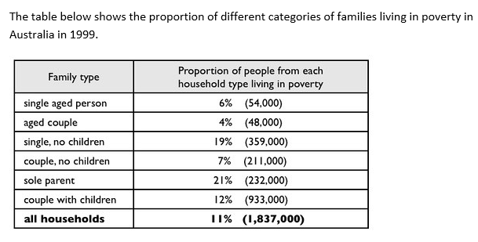

# 05 贫困家庭(表格)

- 题型:表格(Task 1,比例 + 人数;6 种家庭类型 + 总计,单一年份 1999)
- 来源:`小作文/表格/贫困家庭.docx`
- 首次学习:2026-11-13
- 原图:`../question/05.png`(已对照)

## 题目

The table below shows the proportion of different categories of families living in poverty in Australia in 1999.



### 读表数据

表里每一行有两个数字:**比例**(该类家庭中生活在贫困中的人所占的百分比),和括号里的**人数**。

| Family type | 比例(%) | 人数 |
| --- | --- | --- |
| single aged person | 6% | 54,000 |
| aged couple | 4% | 48,000 |
| single, no children | 19% | 359,000 |
| couple, no children | 7% | 211,000 |
| sole parent | 21% | 232,000 |
| couple with children | 12% | 933,000 |
| all households | 11% | 1,837,000 |

> 验算:54,000 + 48,000 + 359,000 + 211,000 + 232,000 + 933,000 = 1,837,000,和总数一致。
> 比例最高的是**单亲家庭**(21%),但人数最多的是**有孩子的夫妇**(933,000,占总数一半以上)。比例和人数,给出的是两个不同的信息。

## 原范文

The table gives information about poverty rates among six types of household in Australia in the year 1999.

It is noticeable that levels of poverty were higher for single people than for couples, and people with children were more likely to be poor than those without. Poverty rates were considerably lower among elderly people.

Just over one fifth of single parents were living in poverty, whereas only 12% of parents living with a partner were classed as poor. The same pattern can be seen for people with no children: while 19% of single people in this group were living below the poverty line, the figure for couples was much lower, at only 7%.

Overall, 11% of Australians, or 1,837,000 people, were living in poverty in 1999. Aged people were the least likely to be poor, with poverty levels of 6% and 4% for single aged people and aged couples respectively.

### 对照原表后的核对结果

| 范文里的说法 | 与表是否一致 |
| --- | --- |
| 单身比夫妇的贫困水平更高 | 一致(老年 6 对 4;无孩子 19 对 7;有孩子 21 对 12) |
| 有孩子的人比没孩子的人更可能贫困 | 一致(单亲 21 对单身无孩 19;有孩夫妇 12 对无孩夫妇 7) |
| 老年人的贫困率明显更低 | 一致(6%、4%) |
| 单亲 just over one fifth | 一致(21%) |
| 有伴侣的父母 12% | 一致 |
| 无孩子的单身 19%,夫妇 7% | 一致 |
| 全体 11%,1,837,000 人 | 一致 |
| 老年人最不可能贫困,单身老人 6%、老年夫妇 4% | 一致,respectively 的顺序也对 |

数据全部正确。**没有写的信息:** 各类家庭的**人数**(括号里的数字)。有孩子的夫妇人数最多,933,000 人,超过总数的一半;而单亲家庭比例最高,人数却只有 232,000。

## 参考修改版(Claude)

The table gives information about poverty rates among six types of household in Australia in 1999.

It is noticeable that levels of poverty were higher for single people than for couples, and people with children were more likely to be poor than those without. Poverty rates were considerably lower among elderly people.

Just over one fifth of sole parents were living in poverty, which was the highest rate in the table, whereas only 12% of parents living with a partner were classed as poor. The same pattern can be seen for people with no children: while 19% of single people in this group were living below the poverty line, the figure for couples was much lower, at only 7%.

Overall, 11% of Australians, or 1,837,000 people, were living in poverty in 1999. Although the rate for couples with children (12%) was lower than that for sole parents, they made up the largest group in poverty, at 933,000 people, or just over half of the total. Aged people were the least likely to be poor, with poverty levels of 6% and 4% for single aged people and aged couples respectively.

### 修改说明

| 位置 | 原文 | 修改 | 原因 |
| --- | --- | --- | --- |
| 开头 | in the year 1999 | in 1999 | the year 多余 |
| 第 3 段 | Just over one fifth of single parents were living in poverty | …, which was the highest rate in the table | 补充:21% 是全表最高的比率 |
| 第 4 段 | (没有) | Although the rate for couples with children (12%) was lower than that for sole parents, they made up the largest group in poverty, at 933,000 people, or just over half of the total. | 补上括号里的**人数**:有孩子的夫妇人数最多;比例和人数的差别是这张表很有意思的一点 |

这篇范文质量很高,数据全对,结构清楚。修改版只补了人数这一点。

## 这篇值得学的地方

**1. 一个表格里有两个量:比例和人数**
括号里的人数不能忽略。两个量说的是不同的事:
- 比例高:单亲家庭(21%),每 5 个人里有 1 个以上贫困。
- 人数多:有孩子的夫妇(933,000),因为这类家庭人口基数大。

写作时可以点出:`Although the rate … was lower than that for …, they made up the largest group in poverty`。

**2. 成对比较**
表里的 6 类家庭可以配成对:
- 老年:单身 6% 对夫妇 4%。
- 无孩子:单身 19% 对夫妇 7%。
- 有孩子:单亲 21% 对夫妇 12%。

每一对都是「单身 > 夫妇」,于是概述就是这个规律:`higher for single people than for couples`。再加上第二个规律:有孩子的比没孩子的更容易贫困。

**3. 描述「可能性」的说法**
`be more likely to be poor than those without`、`the least likely to be poor`。`likely` 用 more / most(`the most likely`,`the least likely`),不写 `likelier`。

**4. 贫困的各种说法(避免重复)**

| 说法 | 例子 |
| --- | --- |
| poverty rate / level of poverty | poverty rates were higher for … |
| the proportion / percentage of … living in poverty | 12% of couples with children |
| living in poverty / below the poverty line | 19% … were living below the poverty line |
| be classed as poor / be poor | only 12% … were classed as poor |

**5. 代词和指代**
- `those without`:those 指 people(复数),`people with children … than those without`。
- `the figure for couples`:the figure **for** + 群体(数据属于谁)。
- `the rate for couples with children … lower than that for sole parents`:rate 是单数,用 that。

**6. 时态**
1999 年是具体年份,数据句用过去时(were living、was、made up)。

**7. 总数的写法**
`11% of Australians, or 1,837,000 people`:`or` 表示同一个数量的另一种说法。

**8. 值得抄的句型(也是介词练习)**

| 句型 | 说明 |
| --- | --- |
| levels of poverty were higher **for** single people than **for** couples | higher **for** X than **for** Y |
| people **with** children were more likely to be poor than those **without** | with / without |
| Just over one fifth of sole parents were living **in** poverty | live **in** poverty |
| 19% … were living **below** the poverty line | below the poverty line |
| the figure **for** couples was much lower, **at** only 7% | the figure for + 群体;at + 数值 |
| **Overall**, 11% of Australians, or 1,837,000 people, were living in poverty **in** 1999 | in 1999 |
| poverty levels **of** 6% and 4% **for** single aged people and aged couples respectively | levels **of** + 数值;**for** + 群体 |
| considerably lower **among** elderly people | among + 群体 |

**9. 五篇表格对比**

| 篇目 | 数据 | 时态 | 重点 |
| --- | --- | --- | --- |
| 表 01 地下铁 | 现状,3 列 | 现在时 | 分组(新旧)、排名 |
| 表 02 垃圾制造 | 3 个年份,吨数,有缺失 | 过去时 | 趋势、倍数、缺失数据 |
| 表 03 手机用途 | 3 个年份,百分比,有缺失 | 过去时 | 按变化模式分组 |
| 表 04 消费开支 | 单一年份,占比,15 个数据 | 过去时 | 比例不是金额;最高 / 最低 |
| 表 05 贫困家庭 | 单一年份,比例 + 人数 | 过去时 | 成对比较;比例和人数 |

---

## 版本 1:我的初稿(待写)

> 建议先不要看上面的修改版,只看题目和原表,限时 20 分钟写一版。写之前先在草稿纸上做三件事:① 把六类家庭配成对,找出每一对的规律;② 找出最高比例和最低比例;③ 看括号里的人数,有没有和比例不一致的地方。写完后原样贴在下面,不要事后改动,先对照 `error-log.md` 的「高频五条」过一遍,再发给我批改。

```text

```

### 写作时重点盯住的几点

1. **开头句:** 圈出主语和动词(The table shows / gives)。
2. **成对比较:** higher **for** X than **for** Y;more likely to be poor than **those** without。
3. **比例和人数:** 区分 proportion / rate 和 number of people。
4. **介词:** living **in** poverty、**below** the poverty line、the figure **for** couples、**among** elderly people、**at** 7%、people **with** children。
5. **最高级:** the least likely、the highest(likely 用 most / least;short 用 -est)。
6. **过去时(写完圈出每个动词);每段用句号收尾;拼写。**