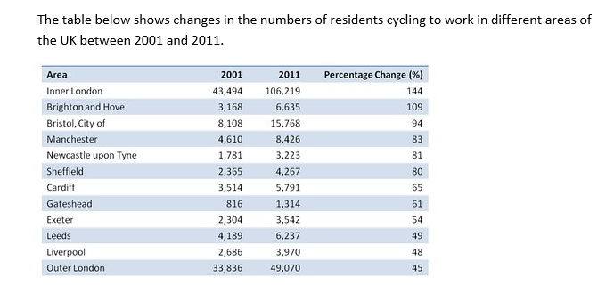

# 06 骑车上班(表格)

- 题型:表格(Task 1,12 个地区 × 两个年份 + 百分比变化)
- 来源:`小作文/表格/骑车上班.docx`
- 首次学习:2026-11-16
- 原图:`../question/06.png`(已对照)

## 题目

The table below shows changes in the numbers of residents cycling to work in different areas of the UK between 2001 and 2011.



### 读表数据

表按 **Percentage Change(百分比变化)从高到低**排序,第三列是现成的,不用自己再算。

| Area | 2001 | 2011 | Percentage change (%) |
| --- | --- | --- | --- |
| Inner London | 43,494 | 106,219 | 144 |
| Brighton and Hove | 3,168 | 6,635 | 109 |
| Bristol, City of | 8,108 | 15,768 | 94 |
| Manchester | 4,610 | 8,426 | 83 |
| Newcastle upon Tyne | 1,781 | 3,223 | 81 |
| Sheffield | 2,365 | 4,267 | 80 |
| Cardiff | 3,514 | 5,791 | 65 |
| Gateshead | 816 | 1,314 | 61 |
| Exeter | 2,304 | 3,542 | 54 |
| Leeds | 4,189 | 6,237 | 49 |
| Liverpool | 2,686 | 3,970 | 48 |
| Outer London | 33,836 | 49,070 | 45 |

> **注意区分:** Inner London(内伦敦,144%)和 Outer London(外伦敦,45%)是两个不同的地区,数量都很大,但增长率一高一低。读表时看清标签。

> 数量最大的三个:Inner London、Outer London、Bristol。**其余所有地区,两个年份都低于 10,000。**

## 原范文

The table compares the numbers of people who cycled to work in twelve areas of the UK in the years 2001 and 2011.

In 2001, well over 43 thousand residents of inner London commuted by bicycle, and this figure rose to more than 106 thousand in 2011, an increase of 144%. By contrast, although outer London had the second highest number of cycling commuters in each year, the percentage change, at only 45%, was the lowest of the twelve areas shown in the table.

Brighton and Hove saw the second biggest increase (109%) in the number of residents cycling to work, but Bristol was the UK's second city in terms of total numbers of cycling commuters, with 8,108 in 2001 and 15,768 in 2011. Figures for the other eight areas were below the 10 thousand mark in both

Overall, the number of UK commuters who travelled to work by bicycle rose considerably over the 10-year period. Inner London had by far the highest number of cycling commuters in both years.

> 原范文里第 3 段最后一句 `…in both` 是不完整的(应为 `in both years`),可能是原文件录入时丢了。

### 对照原表后的核对结果

| 范文里的说法 | 与表是否一致 |
| --- | --- |
| 2001 年内伦敦 `well over 43 thousand` | **略夸张**:43,494 只比 43,000 多 494,写 `just over 43 thousand` 更准 |
| 2011 年 more than 106 thousand,增长 144% | 一致 |
| 外伦敦两个年份都是第二高 | 一致(33,836、49,070) |
| 外伦敦增长 45%,是 12 个地区里最低 | 一致 |
| Brighton and Hove 增长第二大,109% | 一致 |
| `Bristol was the UK's second city in terms of total numbers` | **容易误解**:前面已经说外伦敦是第二,Bristol 其实是**第三**(8,108、15,768) |
| 其余八个地区两个年份都低于一万 | 一致,但 Brighton and Hove(3,168、6,635)也低于一万,准确说是「除伦敦和 Bristol 外的所有地区」 |
| 整体来看,骑车上班的人数大幅上升 | 一致(12 个地区全部上升) |
| `Inner London had by far the highest number … in both years` | **2001 年略夸张**:43,494 对 33,836,差距不大;2011 年(106,219 对 49,070)才算 by far |

数据基本正确。主要问题在**说法的准确度**(well over、second city、by far),**概述放在最后一段**,还有一个残缺的句子。

## 参考修改版(Claude)

The table compares the numbers of residents who cycled to work in twelve areas of the UK in 2001 and 2011, together with the percentage change over the period.

It is clear that the number of cycling commuters rose in every area. Inner London had by far the highest numbers in 2011 and the biggest percentage increase, while the smallest increase was in Outer London.

In 2001, 43,494 residents of Inner London cycled to work, and this figure rose to 106,219 in 2011, an increase of 144%. By contrast, although Outer London had the second highest numbers in both years, at 33,836 and 49,070, its increase, at only 45%, was the lowest of the twelve areas. Bristol had the third highest numbers, rising from 8,108 to 15,768, and all the other areas had fewer than 10,000 cycling commuters in both years.

Brighton and Hove saw the second biggest increase, at 109%, from 3,168 to 6,635, followed by Bristol (94%) and Manchester (83%). At the other end of the table, Liverpool and Leeds recorded rises of 48% and 49% respectively, while the remaining areas saw increases of between 54% and 81%.

### 修改说明

| 位置 | 原文 | 修改 | 原因 |
| --- | --- | --- | --- |
| 开头 | in the years 2001 and 2011 | in 2001 and 2011, together with the percentage change | the years 多余;表里有第三列百分比变化 |
| 结构 | 概述 `Overall …` 放在最后一段 | 概述放到第 2 段 | 概述放在开头之后更稳,考官一眼就能看到 |
| 概述 | rose considerably | rose in every area | 12 个地区全部上升,可以说得更具体 |
| 数据 | well over 43 thousand | 43,494 | 只比 43,000 多 494 |
| 排名 | Bristol was the UK's second city in terms of total numbers | Bristol had the third highest numbers | 外伦敦是第二,Bristol 是第三 |
| 数据 | Inner London had by far the highest number … in both years | …by far the highest numbers in 2011 | 2001 年差距不大(43,494 对 33,836) |
| 残缺 | Figures for the other eight areas were below the 10 thousand mark in both | all the other areas had fewer than 10,000 cycling commuters in both years | 句子不完整;并且「其余」应包含 Brighton and Hove |
| 补充 | (没有) | Liverpool and Leeds recorded rises of 48% and 49% respectively … | 补上增长率最低的几个地区 |

## 这篇值得学的地方

**1. 12 行的大表,不要逐行报数**
12 个地区 × 3 列,要挑选:最高、最低、排名、分层。这张表可以从两个角度分段:
- **数量**(2001、2011):内伦敦和外伦敦远高于其他地区,Bristol 第三,其余都低于 10,000。
- **增长率**(第三列):最高的是内伦敦(144%)、Brighton and Hove(109%)、Bristol(94%);最低的是外伦敦(45%)、Liverpool(48%)、Leeds(49%)。

**2. 数量大,不等于增长率高**
外伦敦的人数排第二,但增长率是全表最低(45%)。这是这张表的一个有趣对比:`although Outer London had the second highest numbers …, its increase … was the lowest`。

**3. 增长率和倍数**

| 增长率 | 意思 | 说法 |
| --- | --- | --- |
| 144% | 变成原来的 2.44 倍 | more than doubled |
| 109% | 变成原来的 2.09 倍 | more than doubled |
| 94% | 差一点翻倍 | almost doubled |
| 45% | 增加了不到一半 | rose by less than half |

**增长 100% 就是翻倍。** 只有内伦敦和 Brighton and Hove 超过了 100%。

**4. 概述的位置和内容**
概述放在开头句之后(第 2 段)。内容:12 个地区全部上升;内伦敦数量最大、增长最大;外伦敦增长最小。

**5. 数字的写法**
表格给的是精确数字,可以直接写 `43,494`,也可以写 `just over 43 thousand`。千位加逗号。

**6. 同一件事的不同说法**
`residents cycling to work`、`cycling commuters`、`residents who cycled to work`、`commuted by bicycle`、`travelled to work by bicycle`。

**7. 排名词**
`the second highest number`、`the third highest numbers`、`the biggest increase`、`the second biggest increase`、`the lowest`。

**8. 时态**
2001、2011 是具体年份,数据句用过去时(cycled、rose、had、saw)。

**9. 值得抄的句型(介词练习)**

| 句型 | 说明 |
| --- | --- |
| this figure rose **to** 106,219 **in** 2011, an increase **of** 144% | rose to + 终点;an increase of + 百分比 |
| although Outer London had the second highest numbers **in** both years, its increase, **at** only 45%, was the lowest **of** the twelve areas | at + 数值;the lowest **of** + 一组 |
| Brighton and Hove saw the second biggest increase (109%) **in** the number **of** residents cycling to work | increase **in** the number **of** |
| Bristol … **in terms of** total numbers | in terms of |
| commuted **by** bicycle | by + 交通工具(无冠词) |
| below the 10 thousand mark | below |
| followed **by** Bristol (94%) and Manchester (83%) | followed by |
| increases **of between** 54% **and** 81% | between … and … |

**10. 六篇表格对比**

| 篇目 | 数据 | 时态 | 重点 |
| --- | --- | --- | --- |
| 表 01 地下铁 | 现状,3 列 | 现在时 | 分组(新旧)、排名 |
| 表 02 垃圾制造 | 3 个年份,吨数,有缺失 | 过去时 | 趋势、倍数、缺失数据 |
| 表 03 手机用途 | 3 个年份,百分比,有缺失 | 过去时 | 按变化模式分组 |
| 表 04 消费开支 | 单一年份,占比 | 过去时 | 比例不是金额;最高 / 最低 |
| 表 05 贫困家庭 | 比例 + 人数 | 过去时 | 成对比较 |
| 表 06 骑车上班 | 12 个地区 × 两个年份 + 增长率 | 过去时 | 数量和增长率两个角度;增长率和倍数 |

---

## 版本 1:我的初稿(2026-11-16,原样保留,不改动)

```text
The table compares the number of resident who cycle to work in twelve area in London in 2001 and 2011, together with the percentages changes over the period.

It is clear that  cycle commuter rose in every areas. In 2001, inner London had by far the higest population and lagest increase, while outer London had the smallest increase.

In 2001, inner London had 43,494 residents to work by cycle, the number rose to 106,219 in 2011, with 144% increase. By contrast, although outer London had 33,869 and 49,070 respecitvely, rank second, its increase rate was only 45%, which is the lowest figure among twelve areas.  The cycle commuter of Bristol rose from 8,108 to 15,768,rank third,that of all the other areas all low 10,000.
```

> 说明:这一份的前两段和「参考修改版」几乎一一对应,第 3 段是你自己组织的。**只有三段,没有写百分比变化那一段**(见下)。

### 逐句批改

**第 1 段(开头)**

| 问题 | 类型 | 改正 |
| --- | --- | --- |
| the number of **resident** | 复数 | residents |
| who **cycle** | 时态:2001、2011 是过去 | who **cycled** |
| twelve **area** **in London** | 复数;**内容错误:12 个地区属于 UK,不在伦敦**(伦敦只有 Inner / Outer London 两个) | twelve **areas of the UK** |
| the **percentages changes** | 单复数;percentage 是形容词 | the percentage change |

> 改正:The table compares the number of residents who cycled to work in twelve areas of the UK in 2001 and 2011, together with the percentage change over the period.

开头句的动词(`The table compares`)这次是对的。

**第 2 段(概述)**

| 问题 | 类型 | 改正 |
| --- | --- | --- |
| **cycle commuter rose** in **every areas** | 上升的是「人数」,不是人;commuters 复数;every + 单数 | **the number of cycling commuters** rose in **every area** |
| **In 2001**, inner London had by far the higest population and lagest increase | **内容错误**:年份应为 2011(2001 年内伦敦 43,494 对外伦敦 33,836,差距不大,不算 by far);**population 是人口,不是骑车人数**;增长是 2001–2011 整个时期的,和「in 2001」矛盾;higest、lagest 拼写 | Inner London had by far the **highest numbers in 2011** and the **biggest percentage increase** |

> 改正:It is clear that the number of cycling commuters rose in every area. Inner London had by far the highest numbers in 2011 and the biggest percentage increase, while Outer London had the smallest increase.

概述的位置对了(放在第 2 段),`rose in every area` 的意思也对。最高级的形式全部正确(highest、largest、smallest、lowest),只是 higest、lagest 拼写错了。

**第 3 段(数量)**

| 问题 | 类型 | 改正 |
| --- | --- | --- |
| inner London had 43,494 **residents to work by cycle** | 结构不通 | 43,494 residents of Inner London **cycled to work** |
| …, the number rose to 106,219 in 2011, **with 144% increase** | 逗号连接两个分句;with 144% increase 缺 an 和 of | and the number rose to 106,219 in 2011, **an increase of 144%** |
| outer London had **33,869** and 49,070 **respecitvely** | **数据错误:应为 33,836**;respectively 拼写;respectively 前面没有对应的两个项目 | had the second highest numbers in **2001 and 2011**, at **33,836** and 49,070 **respectively** |
| , **rank** second, | 逗号后要用分词 | , ranking second(或 had the second highest numbers) |
| its **increase rate** was only 45% | 搭配不自然 | its increase, at only 45%, / its **rate of increase** |
| which **is** the lowest figure **among twelve** areas | 时态;缺 the | which **was** the lowest **of the** twelve areas |
| The **cycle commuter of** Bristol rose | 主语应是 the number of …;commuter 复数;地区用 in | **The number of cycling commuters in Bristol** rose |
| ,rank third,that of all the other areas **all low 10,000** | 逗号连接;`that of all the other areas` 没有谓语;`all low 10,000` 不通 | and all the other areas had **fewer than 10,000** cycling commuters in both years |

> 改正:In 2001, 43,494 residents of Inner London cycled to work, and the number rose to 106,219 in 2011, an increase of 144%. By contrast, although Outer London had the second highest numbers in 2001 and 2011, at 33,836 and 49,070 respectively, its increase, at only 45%, was the lowest of the twelve areas. The number of cycling commuters in Bristol rose from 8,108 to 15,768, ranking third, and all the other areas had fewer than 10,000 cycling commuters in both years.

### 缺少的一段:百分比变化

你的初稿没有写第三列(百分比变化)的其他数据。大表要覆盖两个角度(数量 + 增长率),至少写出每个角度的关键点。参考第 4 段:

> Brighton and Hove saw the second biggest increase, at 109%, from 3,168 to 6,635, followed by Bristol (94%) and Manchester (83%). At the other end of the table, Liverpool and Leeds recorded rises of 48% and 49% respectively, while the remaining areas saw increases of between 54% and 81%.

### 最小修订(保留你的思路,只改错)

The table compares the number of residents who cycled to work in twelve areas of the UK in 2001 and 2011, together with the percentage change over the period.

It is clear that the number of cycling commuters rose in every area. Inner London had by far the highest numbers in 2011 and the biggest percentage increase, while Outer London had the smallest increase.

In 2001, 43,494 residents of Inner London cycled to work, and the number rose to 106,219 in 2011, an increase of 144%. By contrast, although Outer London had the second highest numbers in 2001 and 2011, at 33,836 and 49,070 respectively, its increase, at only 45%, was the lowest of the twelve areas. The number of cycling commuters in Bristol rose from 8,108 to 15,768, ranking third, and all the other areas had fewer than 10,000 cycling commuters in both years.

Brighton and Hove saw the second biggest increase, at 109%, from 3,168 to 6,635, followed by Bristol (94%) and Manchester (83%). At the other end of the table, Liverpool and Leeds recorded rises of 48% and 49% respectively, while the remaining areas saw increases of between 54% and 81%.

### 做得好的地方

- **开头句的动词对了:** `The table compares`。这是你第一次一次写对(前面 5 次出过问题)。
- **概述放在第 2 段,** 内容有层次:所有地区都上升;内伦敦最大;外伦敦增长最小。
- **缺句号:** 3 段都有句号。
- **最高级的形式全对:** highest、largest、smallest、lowest(只有拼写手误)。
- **`By contrast` 拼对了**(constrast 已经错过 4 次)。
- **Bristol 写成「第三」**(`rank third`),避开了原范文 `second city` 的误导。
- **读表准确:** 43,494、106,219、144%、49,070、45%、8,108、15,768 都对;`although … its increase … was only 45%` 的对比也抓到了。

### 本篇的介词和搭配(对照 `grammer.md`)

| 你写的 | 正确 | 规则 |
| --- | --- | --- |
| twelve areas **in London** | twelve areas **of the UK** | 先读题:areas of the UK |
| residents **to work by cycle** | residents **cycled to work** | |
| with 144% increase | **an increase of** 144% | an increase **of** + 百分比 |
| increase **rate** | **rate of** increase / percentage increase | |
| **among** twelve areas | **of the** twelve areas | the lowest **of** the + 数 + areas |
| The cycle commuter **of** Bristol | The number of cycling commuters **in** Bristol | in + 地区 |
| all **low** 10,000 | **below** 10,000 / **fewer than** 10,000 | |
| , **rank** second | , **ranking** second | 逗号后用分词 |
| 33,836 and 49,070 respectively | in 2001 and 2011, at 33,836 and 49,070 respectively | respectively 前先列出对应的两个项目 |
| rose **to** 106,219 **in** 2011 | ✓ 对了 | |
| rose **from** 8,108 **to** 15,768 | ✓ 对了 | |

### 语法笔记

**1. 变化的主语是「人数」(the number of),不是人**
✗ `cycle commuter rose`;✓ `the number of cycling commuters rose`。这是第 3 次:`Ireland rose`(表格 02)、`New York fell`(柱图 02)。

**2. every 后面用单数**
`every area`、`each country`、`every year`。

**3. 增长率的几种写法**

| 写法 | 例子 |
| --- | --- |
| an increase **of** 144% | …rose to 106,219 in 2011, an increase of 144% |
| a 144% increase | …a 144% increase over the period |
| rose **by** 144% | the number rose by 144% |
| its **percentage increase** was only 45% | |
| ✗ increase rate / with 144% increase | |

**4. 抄写数字后逐位核对**
`33,869` 是 `33,836` 抄错了两位。写完把每个数字回到表里,逐位对一遍,包括年份、小数点、逗号。

**5. 概述里的年份和结论要对**
`In 2001 … by far the highest … and largest increase` 里:
- 2001 年内伦敦 43,494 对外伦敦 33,836,不算 by far;2011 年 106,219 对 49,070 才是。
- 增长是 2001–2011 整个时期的变化,不能放在 `In 2001` 下面。
- population 是人口,这里要写 `the number of cycling commuters` / `numbers`。

**6. respectively 前面要先列出两个对应的项目**
`had the second highest numbers in 2001 and 2011, at 33,836 and 49,070 respectively`:前面有 `2001 and 2011`,后面的两个数字才能对应。

**7. 分词:, ranking third**
逗号后面用 ing 分词:`, ranking third,`,不写 `, rank third,`。

**8. 读题:areas of the UK**
题目是 `different areas of the UK`,不是伦敦。伦敦只是其中的 Inner London 和 Outer London 两个地区。

**9. below / fewer than**
`below 10,000`;`fewer than 10,000 cycling commuters`(commuters 可数,用 fewer)。

### 版本 1 对比笔记

**比表格 05 的版本 1 进步的地方**
- 开头句的动词对了。
- 缺句号 0 处;最高级形式全对;`By contrast` 拼对;时态基本是过去时。
- Bristol 排第三,没有照搬原范文的 second city。

**又出现的老问题**
- **变化的主语:** `cycle commuter rose`(第 3 次)。
- **单复数:** 约 8 处(resident、every areas、cycle commuter、percentages changes)。
- **时态:** `who cycle`、`which is`。
- **介词:** with 144% increase、among twelve areas、of Bristol、all low 10,000。
- **读表数据:** `33,869`(抄错数字,和表格 01 的 Tokyo / Kyoto、表格 05 的标签对不上同类,都是核对不够)。

**新出现的问题**
- **内容:** `in London`、概述里的年份写成了 2001、population 当成人数。
- **覆盖不全:** 没有写百分比变化那一段(Brighton and Hove 109%、Liverpool / Leeds 等)。

---

## 版本 2:隔几天后重写(待写)

> 不看上面的任何内容,只看题目和原表,限时 20 分钟。

```text

```

### 写版本 2 时重点盯住的几点

1. **读题:** areas of the UK;概述里的年份和结论逐个核对。
2. **主语:** the number of cycling commuters rose;every + 单数。
3. **覆盖两个角度:** 第 3 段写数量,第 4 段写增长率(最高、最低)。
4. **数字:** 抄完逐位核对(包括 33,836 这样的数字)。
5. **介词:** an increase **of** 144%;**in** Bristol;**below** 10,000;**of the** twelve areas。
6. **respectively 前先列出对应的项目;过去时(圈出每个动词);拼写。**