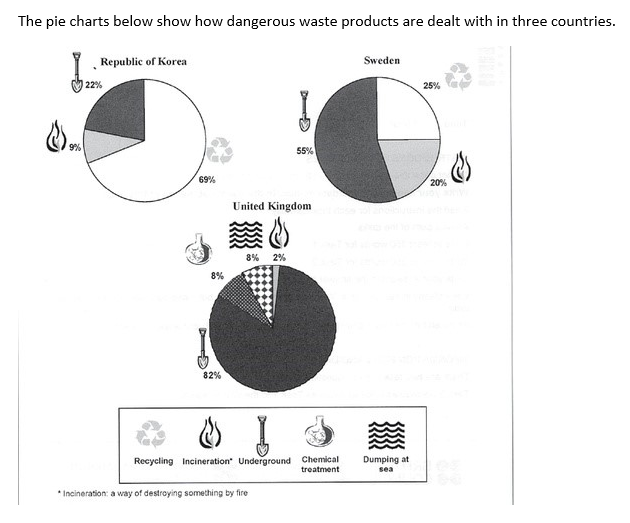

# 01 垃圾处理(饼图)

- 题型:饼图(Task 1,三个饼图:3 个国家 × 5 种处理方法,**没有年份**)
- 来源:`小作文/饼图/垃圾处理.docx`
- 首次学习:2026-11-19
- 原图:`../question/01.png`(已对照)

## 题目

The pie charts below show how dangerous waste products are dealt with in three countries.



### 读图数据

每个饼图加起来是 100%。

| 处理方法 | Republic of Korea | Sweden | United Kingdom |
| --- | --- | --- | --- |
| Recycling(回收) | 69% | 25% | 0 |
| Underground(地下处理 / 填埋) | 22% | 55% | 82% |
| Incineration(焚烧) | 9% | 20% | 2% |
| Chemical treatment(化学处理) | 0 | 0 | 8% |
| Dumping at sea(海洋倾倒) | 0 | 0 | 8% |

> 英国饼图里有三个小块:化学处理 8%、海洋倾倒 8%、焚烧 2%。

## 原范文

The charts compare Korea, Sweden and the UK in terms of the methods used in each country to dispose of harmful waste.

It is clear that in both the UK and Sweden, the majority of dangerous waste products are buried underground. By contrast, most hazardous materials in the Republic of Korea are recycled.

Looking at the information in more detail, we can see that 82% of the UK's dangerous waste is put into landfill sites. This disposal technique is used for 55% of the harmful waste in Sweden and only 22% of similar waste in Korea. The latter country recycles 69% of hazardous materials, which is far more than the other two nations.

While 25% of Sweden's dangerous waste is recycled, the UK does not recycle at all. Instead, it dumps waste at sea or treats it chemically. These two methods are not employed in Korea or Sweden, which favour incineration for 9% and 20% of dangerous waste respectively.

### 对照原图后的核对结果

| 范文里的说法 | 与图是否一致 |
| --- | --- |
| 英国和瑞典的大部分危险废物埋在地下(82%、55%) | 一致 |
| 韩国大部分被回收(69%) | 一致 |
| 英国 82% 填埋;瑞典 55%、韩国 22% 用同样的方法 | 一致 |
| 韩国回收 69%,远高于另外两国 | 一致(瑞典 25%,英国 0) |
| 瑞典回收 25%,英国完全不回收 | 一致 |
| 英国倾倒海洋、化学处理 | 一致,但**没有写比例**:各 8% |
| 英国的焚烧 | **范文没有提到**:英国也有 2% 焚烧 |
| 海洋倾倒和化学处理韩国、瑞典都不用 | 一致 |
| 韩国、瑞典焚烧 9% 和 20% | 一致,respectively 的顺序也对 |

数据全部正确。**漏掉的**:英国的海洋倾倒 8%、化学处理 8%、焚烧 2%。

## 参考修改版(Claude)

The pie charts compare the Republic of Korea, Sweden and the UK in terms of the methods used to dispose of dangerous waste.

It is clear that in both the UK and Sweden, the majority of dangerous waste is buried underground. By contrast, most hazardous waste in the Republic of Korea is recycled.

Looking at the information in more detail, we can see that 82% of the UK's dangerous waste is put into landfill sites. This disposal method is used for 55% of the waste in Sweden and only 22% in Korea. The latter country recycles 69% of its hazardous waste, which is far more than in the other two countries.

While 25% of Sweden's dangerous waste is recycled, the UK does not recycle at all. Instead, it dumps 8% of its waste at sea and treats a further 8% chemically, while only 2% is incinerated. Neither of these two methods, dumping at sea or chemical treatment, is used in Korea or Sweden, which favour incineration for 9% and 20% of dangerous waste respectively.

### 修改说明

| 位置 | 原文 | 修改 | 原因 |
| --- | --- | --- | --- |
| 开头 | The charts compare … | The pie charts compare … | 写清图的类型 |
| 第 4 段 | Instead, it dumps waste at sea or treats it chemically. | it dumps 8% of its waste at sea and treats a further 8% chemically, while only 2% is incinerated | 补上英国三个小块的比例;原范文漏了英国的焚烧 2% |
| 第 4 段 | These two methods are not employed … | Neither of these two methods, …, is used in Korea or Sweden | 否定用 neither … or … |
| 第 3 段 | far more than the other two nations | far more than in the other two countries | 比较对象同类:比例对比例(in the other two countries) |
| 第 3 段 | 69% of hazardous materials | 69% of its hazardous waste | 与其他句子的用词统一 |

这篇范文质量很高,数据全对,结构清楚,修改版补的是英国的三个小比例。

## 这篇值得学的地方

**1. 饼图没有年份 → 一般现在时**
这张图没有给年份,描述的是「危险废物是怎么处理的」,用一般现在时:`is buried`、`is recycled`、`recycles`、`dumps`。
- 有年份(1990、2005 年)→ 过去时。
- 没有年份(饼图、表格 01 地下铁)→ 一般现在时。

**2. 处理方式用被动**
`is buried underground`、`is recycled`、`is put into landfill sites`、`is incinerated`。谁来处理不重要,重要的是「怎么处理」。如果国家是动作的主体,也可以用主动:`The UK does not recycle`、`Korea recycles 69%`。

**3. 三个饼图,按「方法」分段,不按「国家」分段**
同一组方法(回收、填埋、焚烧……)在三个国家里比较:
- 第 3 段:**填埋**(三个国家的对比:英国 82%、瑞典 55%、韩国 22%)和**回收**(韩国 69%)。
- 第 4 段:**回收和其余方法**(瑞典 25%、英国 0;英国独有的海洋倾倒和化学处理;韩国和瑞典的焚烧)。

按方法分段,比分成「韩国一段、瑞典一段、英国一段」更容易比较。

**4. 概述写最主要的方法**
英国和瑞典主要是填埋(大多数),韩国主要是回收。

**5. 同义词(避免重复)**

| 意思 | 说法 |
| --- | --- |
| 危险废物 | dangerous waste / hazardous waste / harmful waste |
| 处理 | dispose of / deal with / handle / treat |
| 地下处理 | buried underground / put into landfill sites |
| 方法 | method / technique / approach / disposal method |

注意:`waste` 是不可数名词。`waste products` 是可数的(危险废物产品)。不说 `waste productions`。

**6. 表示「完全没有」**
`the UK does not recycle at all`、`These two methods are not employed in Korea or Sweden`。否定后面用 or,不用 and。

**7. respectively**
`which favour incineration for 9% and 20% of dangerous waste respectively`:前面先列出 `Korea or Sweden`,后面的两个数字才能对应。

**8. 值得抄的句型(介词练习)**

| 句型 | 说明 |
| --- | --- |
| **in terms of** the methods **used** … **to** dispose **of** … | in terms of;dispose **of** |
| **Looking at** the information **in** more detail, we can see that … | Looking **at** |
| 82% **of** the UK's dangerous waste is put **into** landfill sites | % **of** + 废物;put **into** |
| This disposal technique is used **for** 55% **of** the harmful waste **in** Sweden | used **for** + 比例 |
| which is far more than **in** the other two nations | 比较:in the other two countries |
| dumps waste **at** sea | at sea |
| which favour incineration **for** 9% and 20% **of** dangerous waste **respectively** | incineration **for** + 比例 |

**9. 和其他题型对比**

| | 表格 | 饼图 |
| --- | --- | --- |
| 数字 | 精确 | 图上直接标出,精确 |
| 时态 | 看年份 | **没有年份 → 现在时** |
| 分段 | 按数据特征 | **按类别(方法)** |
| 句型 | 比较、排名 | 占比、被动、「大多数 / 少数」 |

---

## 版本 1:我的初稿(2026-11-19,原样保留,不改动)

> 这一份是你在**还没看到修改版之前**写的,所以它最能反映你现在独立写作的水平。

```text
The bar compares approachs where Republic of Korea 、Sweden and the United Kingdom how to handle dangerous waste productions.

It is clear that in United Kingdom and Sweden, most of dangerous waste productions were underground.By contrast, most of thoes in Republic of Korea was recycled.

Looking the information carefully, we could see that 82% of dangerous waste productions in the United Kingdon was sent to landfill. 55% of dangerous waste production in Sweden was applied in this approach, whiile that for Republic of Korea was only 22%. The last one recycled 69% dangerous waste productions, which was much higher than other two countries.

Although 25% of dangerous waste production in Swenden was recycled, while the United Kingdon didn't. By contrast, it  dumped that at sea or handled that with chermical treatment. Both two approach were not applied in the Republic of Korea and Sweden, and they prefer incineration gangerous waste productions at 9% and 20% respectively.
```

### 逐句批改

**第 1 段(开头)**

| 问题 | 类型 | 改正 |
| --- | --- | --- |
| **The bar** compares | **图的类型错了:这是 pie charts**(饼图) | **The pie charts** compare |
| approachs where … how to handle | 结构不通;approachs 拼写 | the methods used to deal with … |
| Republic of Korea **、**Sweden | 用了中文顿号(第 3 次);Republic 前缺 the | the Republic of Korea, Sweden |
| dangerous waste **productions** | **productions 不对**:waste 不可数,或用 waste products | dangerous waste |

> 改正:The pie charts compare the methods used to deal with dangerous waste in the Republic of Korea, Sweden and the United Kingdom.

**第 2 段(概述)**

| 问题 | 类型 | 改正 |
| --- | --- | --- |
| in United Kingdom | 缺 the | in **the** United Kingdom |
| most of dangerous waste productions **were underground** | most of 后面缺 the;**时态:没有年份,用一般现在时**;were underground 没有动作 | most dangerous waste **is buried underground** |
| most of **thoes** in Republic of Korea **was** recycled | thoes 拼写;those 是复数,配 were / are;缺 the | most of the dangerous waste in the Republic of Korea **is** recycled |

> 改正:It is clear that in the United Kingdom and Sweden, most dangerous waste is buried underground. By contrast, most of the dangerous waste in the Republic of Korea is recycled.

**第 3 段(填埋、回收)**

| 问题 | 类型 | 改正 |
| --- | --- | --- |
| Looking **the** information carefully, we **could** see | **漏 at**;could → can(现在时) | Looking **at** the information carefully, we **can** see |
| 82% of dangerous waste productions in the United **Kingdon** **was** sent | 拼写;时态;82% of + 不可数 waste → is | 82% of dangerous waste in the United Kingdom **is** sent to landfill |
| 55% … in Sweden **was applied in this approach** | 搭配不对:method 是「被使用」,不是「被应用」 | **This method is used for** 55% of the dangerous waste in Sweden |
| **whiile** that for Republic of Korea was only 22% | 拼写;`that for` 用对了;缺 the | while that for **the** Republic of Korea is only 22% |
| **The last one** recycled 69% dangerous waste productions | 指代不清;69% **of** … | **The latter country** recycles 69% **of** its dangerous waste |
| which was much higher **than other two countries** | **比较对象不一致**:比例对比国家;缺 the | which is much higher **than in the other two countries** |

> 改正:Looking at the information carefully, we can see that 82% of dangerous waste in the United Kingdom is sent to landfill. This method is used for 55% of the dangerous waste in Sweden, while that for the Republic of Korea is only 22%. The latter country recycles 69% of its dangerous waste, which is much higher than in the other two countries.

**第 4 段(其余方法)**

| 问题 | 类型 | 改正 |
| --- | --- | --- |
| **Although** 25% … was recycled, **while** the United Kingdon didn't. | **Although 和 while 连用,没有主句**;Swenden、Kingdon 拼写;didn't 不用缩写 | **While** 25% of dangerous waste in Sweden is recycled, the United Kingdom **does not** recycle at all. |
| it dumped **that** at sea or handled **that** with chermical treatment | that 不能当宾语,用 it / waste;chermical 拼写;时态 | it dumps waste at sea or **treats it chemically** |
| **Both two approach were not applied** in the Republic of Korea **and** Sweden | both 和 two 不连用;approach 复数;否定后用 or;时态 | **Neither of these two methods is used** in the Republic of Korea **or** Sweden |
| they prefer incineration **gangerous** waste productions **at** 9% and 20% respectively | gangerous 拼写;结构不通:incineration **for** 9% **of** … | which prefer incineration **for** 9% and 20% **of** dangerous waste respectively |

> 改正:While 25% of dangerous waste in Sweden is recycled, the United Kingdom does not recycle at all. By contrast, it dumps waste at sea or treats it chemically. Neither of these two methods is used in the Republic of Korea or Sweden, which prefer incineration for 9% and 20% of dangerous waste respectively.

### 最小修订(保留你的思路,只改错)

The pie charts compare the methods used to deal with dangerous waste in the Republic of Korea, Sweden and the United Kingdom.

It is clear that in the United Kingdom and Sweden, most dangerous waste is buried underground. By contrast, most of the dangerous waste in the Republic of Korea is recycled.

Looking at the information carefully, we can see that 82% of dangerous waste in the United Kingdom is sent to landfill. This method is used for 55% of the dangerous waste in Sweden, while that for the Republic of Korea is only 22%. The latter country recycles 69% of its dangerous waste, which is much higher than in the other two countries.

While 25% of dangerous waste in Sweden is recycled, the United Kingdom does not recycle at all. By contrast, it dumps waste at sea or treats it chemically. Neither of these two methods is used in the Republic of Korea or Sweden, which prefer incineration for 9% and 20% of dangerous waste respectively.

### 做得好的地方

- **数据全部读对,而且内容覆盖很好。** 你抓到了:英国和瑞典主要是填埋,韩国主要是回收;英国完全不回收;海洋倾倒和化学处理只有英国;焚烧只有韩国和瑞典(9% 和 20%)。**这说明读图没有问题。**
- **缺句号 0 处。**
- **`By contrast` 拼对了**(两处),`respectively` 拼对了,配对也对(Korea 9%,Sweden 20%)。
- **`that for the Republic of Korea was only 22%`** 的 that for 用对了。
- 用了 `much higher than`、`most of`、`The last one`、`Looking … carefully` 这些结构,想法是对的。
- 四段结构完整,有开头句、概述和两个主体段。

### 本篇的介词和搭配(对照 `grammer.md`)

| 你写的 | 正确 | 规则 |
| --- | --- | --- |
| Looking **the** information | Looking **at** the information | looking at |
| was applied **in** this approach | This method is used **for** 55% … | used for + 比例 |
| recycled 69% dangerous … | recycles 69% **of** its dangerous waste | % **of** + 废物 |
| incineration gangerous … **at** 9% | incineration **for** 9% **of** dangerous waste | incineration for + 比例 |
| not applied in A **and** B | not used in A **or** B | 否定后用 or |
| most **of** dangerous waste | most dangerous waste / most **of the** dangerous waste | most of + the |
| higher than **other two countries** | higher than **in the other two countries** | 比较:比例对比例 |
| in the United Kingdom / for 55% / used for | ✓ 对了 | |

### 语法笔记

**1. 时态由「有没有年份」决定**

| 图 | 时态 |
| --- | --- |
| 有具体年份(1990、2005) | 过去时 |
| 没有年份(这张饼图、表格 01 地下铁) | **一般现在时** |

你这篇全篇用了过去时(was、were、recycled、dumped、could),约 12 处。以前一直提醒「有年份 → 过去时」,这次要加上另一半:**没有年份 → 现在时**。

**2. 图的类型要写对**
`The pie charts`、`The bar chart`、`The line graph`、`The table`、`The diagram`。你写成了 `The bar`。

**3. waste 不可数,不说 waste productions**
`dangerous waste`;`dangerous waste products`(可数)。`waste productions` 不对(你写了 6 处)。

**4. most / most of the**
`most dangerous waste`、`most of the dangerous waste`。✗ `most of dangerous waste`(04 的 most of countries 同类)。

**5. 比较:比例对比例**
`much higher than in the other two countries`。✗ `much higher than other two countries`(比例对比国家)。

**6. While 和 although 不连用**
✗ `Although 25% … was recycled, while the United Kingdom didn't.`
✓ `While 25% … is recycled, the United Kingdom does not recycle at all.`
(表格 01 里的 Although … but 同类。)

**7. neither … or … / not … or …**
`Neither of these two methods is used in Korea or Sweden.`。✗ `Both two approach were not applied in … and …`。

**8. 代词**
`dumps waste at sea or treats it chemically`。✗ `dumped that … handled that with …`(that 不能当宾语,用 it)。

**9. 不用缩写**
`does not recycle`,不用 `didn't`。

**10. 中文顿号**
`Republic of Korea 、Sweden` 里的 `、` 要换成英文逗号。这是第 3 次出现(06、表格 03、这篇)。

### 版本 1 对比笔记

**这一份是独立的第一稿(没有看过修改版),所以最能反映真实水平。**

**好的:**
- 读图没有问题:数据全部正确,三个国家的方法对比抓得很准。
- 缺句号 0 处;`By contrast`、`respectively` 拼对;that for 用对。

**需要改的:**
- **时态判断:** 没有年份的图应该用现在时(约 12 处)。
- **拼写手误:** 7 个词 / 9 处,其中 `Kingdon` 出现 3 次。
- **图的类型:** `The bar`。
- **中文顿号**(第 3 次)、**Although … while**、**most of 后缺 the**。
- **新出现:** `Looking the information`、`applied in this approach`、`that` 当宾语、`Both two approach`、`waste productions`。

---

## 版本 2:隔几天后重写(待写)

> 不看上面的任何内容,只看题目和原图,限时 20 分钟。

```text

```

### 写版本 2 时重点盯住的几点

1. **时态:** 没有年份 → 一般现在时;方法用被动(is buried、is recycled)。
2. **图的类型:** The pie charts compare …。
3. **用词:** dangerous waste(不说 waste productions);dispose of / deal with。
4. **比较与搭配:** most of **the** …;higher than **in** the other two countries;Looking **at** …;incineration **for** 9% **of** …。
5. **While(或 Although)单独使用;neither … or …;it 代替 that。**
6. **拼写:** United Kingdom、Sweden、chemical、dangerous、approaches;用英文逗号。